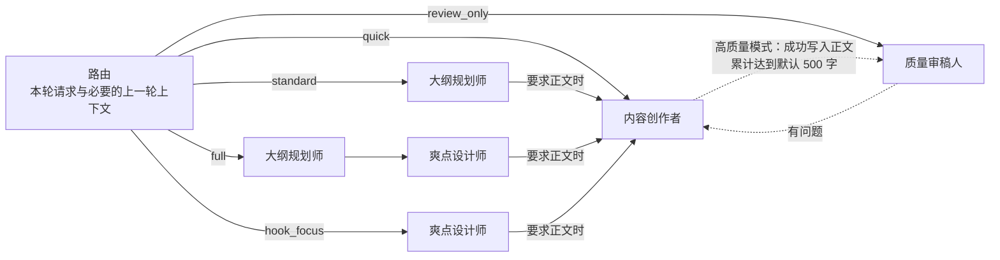

<p align="center">
  
</p>

<h1 align="center">ZenStory 工作台</h1>

<p align="center">
  <b>对话即创作：在浏览器里写小说，AI 直接新建、改写你的大纲、正文和角色卡。</b>
</p>

<p align="center">
  <a href="https://zenstory.ai/zh/workbench"><b>项目主页</b></a>
  &nbsp;·&nbsp;
  <a href="#开始使用"><b>开始使用</b></a>
  &nbsp;·&nbsp;
  <a href="#看看它的输出"><b>看看它的输出</b></a>
  &nbsp;·&nbsp;
  <a href="README_EN.md"><b>English</b></a>
</p>

<p align="center">
  <a href="https://github.com/zenstory-ai/zenstory/stargazers"></a>
  
  <a href="https://app.zenstory.ai/"></a>
  <a href="./LICENSE"></a>
</p>

<p align="center">
  <a href="https://app.zenstory.ai/"></a>
  <a href="https://github.com/zenstory-ai/zenstory/issues"></a>
</p>

> **在线使用：[app.zenstory.ai](https://app.zenstory.ai/)，注册或登录后即可创作。**


工作区从左到右依次是文件树、编辑器和 AI 对话。

## 这是什么

ZenStory 工作台是一个在浏览器里写小说的地方。大纲、正文、角色卡、设定、素材都是项目里的文件，你在右边和 AI 说话，AI 直接新建、改写这些文件，不用来回复制粘贴。可以在 [app.zenstory.ai](https://app.zenstory.ai) 在线用，也可以按 MIT 许可自己部署。

- **在对话里改文件**：说「帮我建一个反派，性格阴沉，有悲情过往」，Agent 会在「角色」文件夹里新建一张角色卡，边写边显示在编辑器里。续写、改写正文也一样，改动直接落进文件。
- **一个路由，四个专职 Agent**：路由结合本轮请求和必要的上一轮上下文选择流程，由大纲规划师、爽点设计师、内容创作者、质量审稿人接力。只要规划就停在规划；明确要求正文时才安排写作。高质量模式默认在成功写入的正文累计达到 500 字时自动送审，聊天和大纲不计入。审稿人只读，有必要修复的问题才交回修改。
- **改稿有版本可查**：AI 在对话里改文件会记录版本，编辑卡片可以撤销。你在编辑器保存的连续修改会合并到最近的手动版本，超过合并时间窗再建新版本；手动版本额度用完仍会保存正文。AI 正常完成一轮后还会记录项目快照。
- **每轮带上该带的资料**：在约 32000 token 的预算里，给 AI 带上「AI 记忆」的四栏（项目简介、写作风格、当前阶段、备注，太长会被截短）、项目文件清单、你正在编辑的文件、同一文件夹里的上一章和最近改过的几份文件，以及最近改过的角色和设定。
- **别的 Agent 也能接进来**：在设置里生成 API Key，用 `npx zenstory login` 在终端登录、`npx zenstory skill install` 装上技能，Claude Code、Codex、OpenClaw 这类 Agent 就能读写你的项目。

## 工作台里有什么

<table>
  <tr>
    <td></td>
    <td></td>
  </tr>
  <tr>
    <td align="center">打开章节，在右边写请求</td>
    <td align="center">长篇项目默认五个文件夹：设定、角色、素材、大纲、正文</td>
  </tr>
</table>

### 多 Agent 分工



| 流程 | 谁来做 | 什么时候走 |
| --- | --- | --- |
| quick | 内容创作者直接写 | 续写、扩写等日常请求，路由拿不准时也走这条 |
| standard | 先规划；同时要求正文时再写 | 你要大纲、规划、梗概、章节结构 |
| full | 按本轮范围安排规划、爽点设计和写作 | 你明确要完整流程、重要章节或高潮戏 |
| hook_focus | 先设计爽点、反转或节奏；要求改稿时再写 | 你说不够爽、太平淡、要反转 |
| review_only | 只审稿，不改文件 | 你要检查、评估、追更指数 |

输入框上可以切换「高质量」和「快速」两种模式，用的是同一个模型。「高质量」默认先路由，再按成功写入的正文字数自动送审；「快速」直接交给内容创作者，关闭这道自动送审检查。写作提示仍要求较长稿件交接审稿，因此快速模式也可能出现审查。规划和修改都遵守这次请求的范围。

生成过程中还能在输入框追加指令。正在工作的 Agent 这一轮里看不到它；这一轮做完后，有下一个 Agent 就由下一个接着处理，没有就让当前 Agent 再补一轮按它调整。正在写的内容不会被打断。

### 14 个内置技能

| 分类 | 技能 |
| --- | --- |
| 写作 | 续写正文 · 开头生成 · 短篇写作 · 短剧剧本正文生成 |
| 情节 | 创建大纲 · 钩子设计 · 短剧改编分析 · 短剧故事概要生成 · 短剧分集集纲生成 |
| 文风 | 润色修改 · 节奏控制 · 去AI味 |
| 角色 | 创建角色 |
| 世界观 | 世界观设定 |

官方技能的用途与方法保存在数据库，维护方式见[写作指引来源](docs/agent-writing-guidance.md)。在「技能 → 发现技能」添加后，AI 每轮先看到已启用技能的名称和用途，匹配请求时再加载完整方法；也可以在输入框打 `/`，或在侧栏点选技能，附在当前消息上，最多 3 个。

自定义技能使用开放 Agent Skills 格式的 `SKILL.md`，可附 `references/` 资源，并以 `.zip` / `.md` 导入或导出。导入包中的脚本会被丢弃并提示；分享的技能经管理员审核后公开。

### 版本、快照与导出


- 停笔约 3 秒自动保存。手动保存的连续修改默认在 10 分钟内合并到最近的手动版本，离开合并窗口后新建版本；即使只改几个字也会纳入。AI 修改另记「AI 编辑」版本，不占手动版本额度。
- 编辑器底部的「历史」按钮打开当前文件的版本：任选两个版本逐行比较，或把文件回滚到某个版本。回滚不删旧版本；版本额度没满时，回滚后的内容记成一个新版本。恢复前，尚未进入历史的当前稿会先备份；备份失败则取消恢复。未保存的编辑仍需先保留。
- 顶栏的历史图标（提示「版本历史」）打开整个项目的快照列表：可以比较两次快照，也可以把整个项目回滚到某一次。快照记录各文件的版本与结构；恢复前会创建回滚前快照。整项目恢复还会移除目标快照之后新建的文件，先核对范围并保留浏览器里未保存的稿件。
- 「导出正文」把正文和剧本按章节顺序合成一个 TXT；「导出大纲和正文」可同时包含大纲。角色卡和设定不在这两种导出范围内。

### 素材库与灵感库

- **素材库**：上传一本 TXT 参考小说（不超过 30 万字），后台默认拆出每章摘要、全书概要、角色档案、世界观和金手指；逐章情节点及其下游（跨章剧情与故事线、人物关系）默认关闭，可用 `MATERIAL_ENABLE_*` 开关开启（见 `apps/server/.env.example`）；关闭后每章仍有摘要和角色提取两次全文调用（开启情节点时为三次）。AI 不会自己去翻素材库，要用时附加到对话或导入项目（见[常见问题](#ai-会自动参考素材库里的书吗)）。在线版的完整素材库是 Pro 权益，启用免费试拆的环境会显示一次试用入口，按页面给出的章节范围保留和处理开篇。
- **灵感库（可选，默认关闭）**：官方上架的，以及用户投稿、经管理员审核通过的整套项目模板。启用后，点「使用此模板」会新建一个项目，把模板里的文件都复制进去。后端设 `INSPIRATIONS_ENABLED=true` 后重启服务，前端设 `VITE_INSPIRATIONS_ENABLED=true` 并重新构建（开发模式重启 Vite）；快速 Docker 部署只需设 `INSPIRATIONS_ENABLED=true` 后重新创建容器。关闭时隐藏灵感库入口、推荐、投稿和相关权益，并禁用用户与管理 API；已有数据保留，不影响输入自己的创意创建项目。

### 其他

- 新建项目时选长篇小说、短篇小说或短剧剧本，三种的默认文件夹和 AI 收到的写作指引都不一样。
- 能把写好的稿子导进来，按章节标题自动拆成多个文件（见[常见问题](#能把已经写好的稿子导进来吗)）。
- `Cmd+K`（Windows 上 `Ctrl+K`）按标题搜索项目里的文件。
- 对话框里有语音输入（腾讯云一句话识别），识别出的文字填进输入框。
- 中文和英文界面；深色、浅色主题在设置里切换；手机浏览器里是「文件 / 编辑 / AI」三个底部标签。

## 开始使用

### 在线版

打开 [app.zenstory.ai](https://app.zenstory.ai) 注册即可，不需要邀请码。免费版每天 3 条 AI 消息（北京时间 00:00 重置）、最多 3 个项目，各套餐的对比见[定价页](https://app.zenstory.ai/pricing)。

新建一个「短篇小说」项目，第一条请求可以先要一份能改的提纲，不急着写正文（示例来自[快速开始](https://zenstory.ai/docs/getting-started/quick-start)）：

> 我想写一篇现实悬疑短篇。先只给三场景提纲，暂不写正文，也不要创建或修改文件。现在五点四十分，车站失物招领窗口六点关闭。值班员林禾处理沈敏对灰色帆布包的认领：她准确说出包的外观，却说错了内袋里的一件物品。不要直接认定她偷窃，也不要替我决定真相。林禾不能仅凭口头认领交付物品。每个场景写：地点、人物当下目标、可见行动、信息变化、场景结束时留下的问题。最后列出两个必须由我决定的故事选择，然后停止。

提纲定了，再点名文件让它落盘（第三行的「钩子设计：」要先在「技能 → 发现技能」里添加这个技能）：

```text
把刚才的三场提纲存成「构思」文件夹里的「失物招领 提纲」。
按「失物招领 提纲」写第一场，存成「正文」文件夹里的「第1场 认领」，写完这一场就停。
钩子设计：只改「第1场 认领」最后两段，给它换一个结尾钩子。
```

更多用法见[使用文档](https://zenstory.ai/docs)。

### 自己部署

需要 Docker 和一个 [DeepSeek API Key](https://platform.deepseek.com/api_keys)：

```bash
export DEEPSEEK_API_KEY=your-key          # 也可以写进仓库根目录的 .env
docker compose up -d --build

# 第一个账号：管理员，不需要邀请码和邮箱验证。
# 换成你自己的邮箱和密码，密码至少 12 位（CHANGE-ME 不够长，会被拒绝）
docker compose exec -e ZENSTORY_ADMIN_EMAIL=you@example.com \
  -e ZENSTORY_ADMIN_PASSWORD='CHANGE-ME' server python scripts/create_admin.py

# 项目提示词只存数据库：在管理后台配置 novel、short、screenplay 并重新加载。
# 官方技能也只存数据库，不再附带源码种子；维护见 docs/agent-writing-guidance.md。
```

打开 <http://localhost:5173> 登录，API 文档在 <http://localhost:8000/docs>。数据库是 SQLite，和上传文件一起放在 Docker 卷里，`docker compose down` 和重新构建都不会清掉。

每个账号（包括管理员）默认都是免费套餐：每天 3 条 AI 消息（北京时间 00:00 重置）、最多 3 个项目。需要更多额度时，先运行 `docker compose exec server python scripts/seed_subscription_plans.py` 创建 Pro 套餐（也会建好免费套餐这一行），再在管理后台「订阅管理」里给账号开通 Pro。

写作 Agent 默认用 DeepSeek 的 `deepseek-flash`（DeepSeek-V4.1-Flash），只需要这一个 Key（可选的主备模型见下面「能换别的大模型吗？」）。其他功能各要各的配置：用上面的快速启动时，后端变量加到 `docker-compose.yml` 里 `server` 的 `environment` 下，`VITE_*` 加到 `web` 下，再运行 `docker compose up -d`；仓库根目录的 `.env` 只给 compose 文件里的 `${…}` 取值（比如 `DEEPSEEK_API_KEY`、`JWT_SECRET_KEY`），不会把别的变量带进容器。换成 `docker-compose.full.yml` 时，变量写进 `apps/server/.env.docker` 和 `apps/web/.env.docker`。

<details>
<summary>可选功能需要的配置</summary>

| 功能 | 需要的配置 |
| --- | --- |
| 让别人注册 | 默认要邀请码，管理员在后台「邀请系统」生成；不要邀请码就设 `AUTH_REGISTER_INVITE_CODE_OPTIONAL=true` |
| 积分与邀请（可选，默认关闭） | 前端 `VITE_POINTS_ENABLED=true` 显示积分页和签到，`VITE_REFERRAL_ENABLED=true` 显示「设置 → 邀请」和注册页的可选邀请码；改后重新构建前端 |
| 邮箱注册的验证码 | `REDIS_URL`、`RESEND_API_KEY`、`RESEND_FROM_EMAIL`；快速启动不带 Redis，要用 `docker-compose.full.yml` |
| 重启后保持登录 | `JWT_SECRET_KEY`（至少 32 字符；快速启动时可以写进根目录的 `.env`） |
| 语音输入 | `TENCENT_SECRET_ID`、`TENCENT_SECRET_KEY` |
| Google 登录 | 后端 `GOOGLE_CLIENT_ID`、`GOOGLE_CLIENT_SECRET`、`GOOGLE_REDIRECT_URI`、`FRONTEND_URL`；前端 `VITE_GOOGLE_OAUTH_ENABLED=true` |
| 素材库拆解 | 另外运行 Prefect server 和 worker（见 [`apps/server/prefect.yaml`](apps/server/prefect.yaml)），并在套餐里打开素材库权限 |
| 外部 Agent 接入 | `API_BASE_URL=https://你的服务器/api/v1`（后端地址，写进 `/skill.md`）。设置页按前端的 `VITE_API_BASE_URL` 给出 `npx zenstory login --api-base <后端地址>/api/v1` 和 `<后端地址>/skill.md`；CLI 只接受 https，本机的 `localhost` / `127.0.0.1` 例外 |
| 兑换码 | `REDEMPTION_CODE_HMAC_SECRET`（至少 32 字符），并先建好 Pro 套餐 |
| 支付宝在线开通 / 续费 | 后端 `ZPAY_ENABLED=true`、`ZPAY_PID`、`ZPAY_KEY`、`ZPAY_NOTIFY_URL`、`ZPAY_RETURN_URL`，可选 `ZPAY_CID`；先建好 Pro 套餐并设置月付 / 年付价格 |

</details>

### 可选：Zpay 支付宝收款

在线支付默认关闭。启用后，用户可通过支付宝购买 Pro：月付开通 30 天、年付开通 365 天，同套餐续费延长到期时间；兑换码仍保留为次要入口。价格从后端套餐配置读取，管理后台「支付订单」可查看订单和权益发放状态。

商户密钥只配置在后端环境变量中，不要提交到仓库，也不要使用 `VITE_*` 变量。`ZPAY_NOTIFY_URL` 使用公开可访问的后端 HTTPS 地址，例如 `https://api.example.com/api/v1/payments/zpay/notify`；`ZPAY_RETURN_URL` 使用前端 `https://app.example.com/dashboard/billing/payment-return`。两者都不能预设查询参数或片段。生产异步回调应直连后端，不经过前端代理。

上线前先应用数据库迁移并验证 `payment_order` 表存在，再启用支付。会员只在后端验证 Zpay 签名、商户、金额和订单后发放，浏览器返回页不会直接开通会员。关闭新支付时设置 `ZPAY_ENABLED=false`，保留密钥和回调地址以处理已有订单的通知。接口协议见 [Zpay 官方文档](https://zpayz.cn/doc.html)。

<details>
<summary>不用 Docker，本地开发</summary>

需要 Node.js 20.19+、Python 3.12 和 pnpm：

```bash
# 终端 1：后端（端口 8000）
cd apps/server
python3 -m venv venv && source venv/bin/activate
pip install -r requirements.txt
cp .env.example .env          # 填上 DEEPSEEK_API_KEY
python3 main.py

# 终端 2：前端（端口 5173）
cd apps/web
pnpm install
cp .env.example .env.local
pnpm dev
```

第一个账号同样用 `scripts/create_admin.py` 创建（在 `apps/server` 下带上 `ZENSTORY_ADMIN_EMAIL`、`ZENSTORY_ADMIN_PASSWORD` 运行）。可选功能的变量写进 `apps/server/.env` 和 `apps/web/.env.local`。

</details>

PostgreSQL + Redis 的部署方式、以及再建账号、改端口等细节见 [docs/docker-compose.md](docs/docker-compose.md)。

## 看看它的输出

第一节保留去 AI 味的历史对照示例。后两节来自一次 API 实跑：从干净检出按[自己部署](#自己部署)起服务，新建长篇项目「失物招领」，再写入测试章节并读取结果。章节文字未调用 AI 生成，省略处以「……」标出。

### 去 AI 味的历史对照示例

[早期写作提示词](https://github.com/zenstory-ai/zenstory/blob/bc780ae03ec95440f3277c992ad2c464a74ac49f/apps/server/agent/prompts/subagents.py)留下了以下对照示例。示例原文保留；其中的禁词规则已被现行方法取代。

```markdown
### 禁用词汇
绝对禁止使用以下AI高频词汇：
- 仿佛、好像、犹如、一丝、一抹
- 深吸一口气、缓缓、不禁
……
### 正确替代示例
- ❌ '他感到一丝愤怒' → ✅ '他攥紧了拳头'
- ❌ '她的眼中闪过一抹惊讶' → ✅ '她愣了一下'
- ❌ '"你好。"他说道' → ✅ '"你好。"他点了点头'
```

[现行写作提示词](apps/server/agent/prompts/subagents.py)按原意、视角、线索、钩子与人物声线定位问题，不按词语黑名单或删减比例改稿。篇幅跟随作者要求；安静、文学或开放式结尾也按作品需要处理。

### 章节按标题里的序号排，导出也按这个顺序

在「正文」文件夹里依次新建：第十章、序章、第2章、第一章、第一百零二章。文件树返回的顺序：

```text
第一章 五点四十分
第2章 灰色帆布包
第十章 六点关门
序章
第一百零二章 尾声
```

中文数字和阿拉伯数字混着写也能排对。「序章」没有序号，排在建它那一刻已有文件的后面，所以落在第十章之后；想让它排在最前，就趁「正文」里还没有别的文件时先建它（另建一个项目实测过：先建序章，顺序是序章、第一章、第2章）。

「导出正文」按同样的顺序合成一个 TXT，开头是这样：

```text
第一章 五点四十分

五点四十分，林禾把登记簿翻到今天那一页。
沈敏说包是灰色的帆布包，内袋里有一把折叠伞。
窗口六点关。

---

第2章 灰色帆布包

第2章的正文。

---
……
```

### 让 Claude Code 接进来

在「设置 → Agent」里创建 Key，然后在自己的终端里运行（需要 Node.js 20+）：

```bash
npx zenstory login           # 出现 "Paste API key:" 时粘贴 Key，输入不显示，也不进 shell 历史
npx zenstory skill install   # 把技能装到 Claude Code；Codex、OpenClaw 加 --target codex / --target openclaw
npx zenstory whoami          # 确认登录状态和读写权限
```

自己部署的，登录时加上 `--api-base https://你的服务器/api/v1`（设置页会直接给出带这个参数的命令）。Key 不要贴进 AI 对话；已经贴过的，到「设置 → Agent」重新生成。

装好技能后，Agent 通过 ZenStory 命令行工具（`zenstory`）读写项目。技能里写好的续写流程：

```bash
dir=$(mktemp -d)                                                          # 暂存这次读取的稿件
zenstory files list <项目ID> --type draft --fields id,title --json           # 列出草稿
zenstory context <项目ID> --file <章节ID> --query "接下来写什么" --json        # 相关上下文
zenstory files get <章节ID> --fields updated_at --json                       # 记下 updated_at
zenstory files get <章节ID> -o "$dir/<章节ID>.md"                            # 读到 mktemp -d 建的临时目录
zenstory files put <章节ID> --content-file "$dir/<章节ID>.md" --if-updated-at <updated_at>   # 写回
```

其他 Agent 也可以直接读 `https://api.zenstory.ai/skill.md`，里面有 HTTP 接口说明。

用这把 Key 走第 1 步，拿到的就是上面那几章，顺序和文件树一样：

```json
{
 "files": [
  { "id": "9f079009-2732-4230-9d2c-2c9caf48d10a", "title": "第一章 五点四十分" },
  { "id": "76099953-a196-47c5-a38a-6e88c2632050", "title": "第2章 灰色帆布包" },
  ……
 ],
 "total": 5,
 "limit": 50,
 "offset": 0
}
```

Agent 用自己的模型写，ZenStory 负责存稿和整理上下文。`files put` 写回的是整篇覆盖，所以有几道保护：你在网页里改过（`updated_at` 变了）就拒绝写入；新稿不到原稿一半长时要显式加 `--allow-shrink`；服务器会在版本历史里记一个版本（版本额度用完时只存正文、不记版本），写坏了用 `zenstory files versions <章节ID>` 找到旧版本，再 `zenstory files rollback <章节ID> <版本号> --yes` 恢复；写入前还会把服务器上的旧稿存一份到本机 `~/.cache/zenstory/backups/`。用 CLI 新建的项目和网页里一样带默认文件夹，新章节用 `--order` 排在正确的位置。

## 常见问题

### 在线版注册要邀请码吗？

不用。打开 app.zenstory.ai 注册即可。在线版目前关闭了邀请和积分，注册页不显示邀请码。

### 自己部署后，第一个账号怎么建？别人怎么注册？

第一个账号用 `scripts/create_admin.py` 建，命令见[自己部署](#自己部署)，它不需要邀请码，也不用验证邮箱。别人注册默认要邀请码，管理员在后台「邀请系统」生成（前端设 `VITE_REFERRAL_ENABLED=true` 后，「设置 → 邀请」也能生成）；不要邀请码，就在 `docker-compose.yml` 的 `server.environment` 下加 `AUTH_REGISTER_INVITE_CODE_OPTIONAL: "true"`（本地开发写进 `apps/server/.env`），再 `docker compose up -d`；前端可在 `web.environment` 下再加 `VITE_INVITE_CODE_OPTIONAL: "true"`，让表单一开始就按可选处理（邀请关闭时不显示邀请码，开启时显示「邀请码（可选）」）（[#1](https://github.com/zenstory-ai/zenstory/issues/1)）。用邮箱注册的人要收到验证码才能登录，这需要 Redis 和 `RESEND_API_KEY`。

只给几个信得过的人用，也可以再运行 `create_admin.py`，换上对方的邮箱和一个新的 `ZENSTORY_ADMIN_USERNAME`（默认是 `admin`，不能重复）。这样建的都是管理员账号，能进管理后台改提示词、套餐和用户；建好后在后台「用户管理」里编辑这个账号，取消「超级用户」。

### 能换别的大模型吗？

可以用环境变量在 DeepSeek 和 MiniMax 之间选主用和备用，各自可以指定模型名：`LLM_PRIMARY_PROVIDER` / `LLM_PRIMARY_MODEL`、`LLM_BACKUP_PROVIDER` / `LLM_BACKUP_MODEL`，Key 分别是 `DEEPSEEK_API_KEY`、`MINIMAX_API_KEY`。主用不可用（连不上、超时、限流、5xx、Key 失效）时，这个会话窗口改用备用。完整说明见 [`apps/server/agent/core/llm_providers.py`](apps/server/agent/core/llm_providers.py)；新模型要先在 `apps/server/services/usage/pricing.py` 里加上价格。

### 能导出 Word，或者直接发布到小说平台吗？

都不能。「导出正文」只出一个 TXT：UTF-8 带 BOM，Windows 记事本能直接打开，文件名是「项目名_正文.txt」。要其他格式，拿这个 TXT 到本地软件里排版；发布到平台也要自己上传（[#13](https://github.com/zenstory-ai/zenstory/issues/13)）。

### AI 改我的稿子前会先问我吗？改坏了怎么撤回？

不会先问。Agent 在对话里的修改直接保存进文件，同时存一个「AI 编辑」版本。对话里的编辑卡片逐条列出改前和改后的片段，点「撤销」会把文件退回上一个版本；也可以点编辑器底部的「历史」，把这个文件回滚到任意一个版本。只想讨论、不想让它动文件，就在请求里写明「暂不创建或修改文件」，路由识别为只读请求后，会拒绝文件写工具；回复中仍要确认它按要求处理。编辑器里选中文字点「去AI味」时是另一回事：改写结果先按段落对比显示，逐段接受或拒绝后才保存。

### 聊了很久，AI 还记得最开始说的设定吗？

不靠聊天记录记。每轮只把最近约 32000 token 的对话发给模型，更早的不发，也不做摘要；上一两轮读过或改过的文件会按当前最新内容附上全文（有上限）。资料另有一份约 32000 token 的预算：「AI 记忆」四栏、项目文件清单、当前文件、同一文件夹里的上一章和最近改过的几份文件，以及最近改过的角色和设定；项目简介和备注太长会被截短，文件多时清单只列一部分。要长期记住的要点，简短地写进「AI 记忆」，细节放进角色卡、设定文件。需要长期保留的要求，可在「AI 记忆」里确认。AI 对备注的更新会作为提议，已确认和原有条目保留；以面板中的实际内容为准。

### 「快速」和「高质量」模式有什么区别？

两者模型相同，「快速」省去路由和按字数自动送审，适合直接写作；「高质量」按请求安排分工并自动核对正文（见[多 Agent 分工](#多-agent-分工)）。审稿优先看作者要求、事实连续性和因果，不用主观分数作返工门槛；每次请求最多两轮审查，达到上限后不再自动返修。

### AI 会自动参考素材库里的书吗？

不会。要让它读到，在项目的「参考小说库」面板里把条目「附加到聊天」（每条消息最多 5 个），或者导入项目变成文件；导入后的文件和其他项目文件一样，能被检索到。

### 免费版有哪些限制？

在线版免费套餐：每天 3 条 AI 消息（北京时间 00:00 重置），最多 3 个项目，每个文件有 10 个手动版本名额（满额后仍保存正文，可合并的连续修改继续合并），导出 TXT，最多 3 个自定义技能；完整素材库是 Pro 功能，是否提供免费试拆及其范围，以页面入口和提示为准。免费套餐不会到期。自动建议不占每日 AI 消息。

### 能把已经写好的稿子导进来吗？

能。把鼠标移到「正文」文件夹上，点右侧的「+」（提示「上传正文」），一次最多 20 个 .txt 或 .md，每个不超过 5MB、50 万字。文本里有两个以上章节标题时，会按「第X章」「卷X」「序章」「楔子」「番外」「Chapter N」这类标题拆成多个正文文件。

### 忘记密码怎么办？

在线版没有自助重置。用注册邮箱写信到 support@zenstory.ai。

## 延伸阅读

- [快速开始](https://zenstory.ai/docs/getting-started/quick-start)：从空项目到第一份能改的提纲。
- [第一篇短篇](https://zenstory.ai/docs/getting-started/first-project)：一个原创短篇的文件安排和三段范围明确的请求。
- [AI 创作助手](https://zenstory.ai/docs/user-guide/ai-assistant)：焦点文件、引用文字，以及中断后怎么接着写。
- [AI 记忆](https://zenstory.ai/docs/advanced/ai-memory)：四栏怎么填，写错了怎么改。
- [版本历史](https://zenstory.ai/docs/user-guide/version-history)：单个文件恢复和整个项目快照的区别。
- [从参考片段写到自己的场景](https://zenstory.ai/docs/advanced/material-analysis)：拆完参考小说，怎样写出自己的戏。
- [写作环境对比](https://zenstory.ai/zh/compare/writing-workflows)：普通聊天、Oh Story skill 包、DSH 插件和 ZenStory 工作台各适合什么。
- [AI 续写怎么保持文风](https://zenstory.ai/zh/oh-story/preserve-author-voice)：把文风拆成说得清的几点，附一段自己的样本。

## 参与贡献

- **GitHub Issues**：[提交 Bug](https://github.com/zenstory-ai/zenstory/issues/new?template=bug_report.md) · [功能建议](https://github.com/zenstory-ai/zenstory/issues/new?template=feature_request.md)。在线版里也可以从项目页右上角「…」→「问题反馈」提交，能附截图。
- 改代码前先读 [CONTRIBUTING.md](CONTRIBUTING.md)。多 Agent 工作流、工具和 SSE 事件的细节在 [`apps/server/agent/AGENTS.md`](apps/server/agent/AGENTS.md)。

<details>
<summary>项目结构与技术栈</summary>

```
zenstory/
├── apps/web/                 # React 前端
│   ├── src/components/       #   Layout、sidebar/FileTreePane、Editor、ChatPanel、skills …
│   ├── src/pages/            #   Dashboard、项目、素材库、定价 …
│   └── docs/                 #   使用文档源文件，发布到 zenstory.ai/docs
└── apps/server/              # FastAPI 后端
    ├── api/                  #   路由：auth、projects、files、agent、agent_api、materials、admin …
    ├── agent/                #   写作 Agent
    │   ├── graph/            #     路由、交接、自动审稿的调度循环
    │   ├── tools/            #     文件、项目、技能和交接工具
    │   ├── context/          #     每轮上下文的组装、预算和优先级
    │   ├── prompts/          #     共享协议与角色提示，项目写作配置在数据库
    │   └── skills/           #     技能加载与注入，官方技能正文在数据库
    ├── flows/                #   素材拆解流水线（Prefect）
    ├── services/             #   业务逻辑
    └── models/               #   数据模型
```

| 层 | 技术 |
| --- | --- |
| 前端 | React 19 · TypeScript · Vite 7 · Tailwind CSS 4 · Zustand · TanStack Query |
| 后端 | FastAPI · SQLModel · Server-Sent Events |
| AI | DeepSeek `deepseek-flash`（DeepSeek-V4.1-Flash，OpenAI 兼容接口）· openai-agents-python |
| 检索 | 数据库关键词匹配、相关片段与行号；文件编辑后立即可搜，无索引任务 |
| 数据 | SQLite（默认）/ PostgreSQL · Redis · Alembic |
| 部署 | Docker Compose；在线版前端在 Vercel，后端与 Prefect 在 Railway |

</details>

## 许可证

[MIT License](LICENSE) &copy; 2024-2026 ZenStory

## ZenStory AI 项目

ZenStory 工作台由 [ZenStory AI](https://zenstory.ai/zh) 维护——一组开源、面向 agent 的故事创作、改编与生产工具（GitHub 组织：[zenstory-ai](https://github.com/zenstory-ai)）。同组织项目：

| 项目 | 用途 |
| --- | --- |
| [oh-story-claudecode](https://github.com/zenstory-ai/oh-story-claudecode) | 网文写作 skill 包：扫榜、拆文、写作、去AI味、封面图 |
| [drama-skills](https://github.com/zenstory-ai/drama-skills) | AI 短剧 / 漫剧创作 skill 合集：剧本、资产、分镜、图片/视频提示词、独立审查 |
| [novel-to-game](https://github.com/zenstory-ai/novel-to-game) | 面向原著改编、指定运行环境构建与运行证据 QA 的 agent skills |
| [video-recap-skills](https://github.com/zenstory-ai/video-recap-skills) | 将支持的视频文件制作成中文解说，可选导出可编辑的剪映/CapCut 草稿 |
| [oh-story-dsh](https://github.com/zenstory-ai/oh-story-dsh) | DeepSeek Harness 社区插件，提供小说、短剧、游戏和视频解说工作台 |
| [zenstory](https://github.com/zenstory-ai/zenstory) | 对话即创作的 AI 小说写作工作台，在线版 [app.zenstory.ai](https://app.zenstory.ai)（本仓库） |
