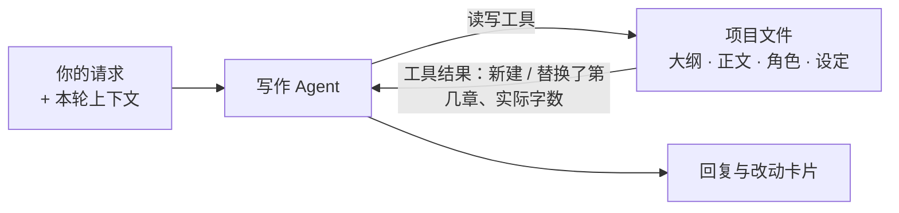

<p align="center">
  
</p>

<h1 align="center">ZenStory 工作台</h1>

<p align="center">
  <b>对话即创作：在浏览器里写小说与短剧，AI 直接新建、改写你的大纲、正文和角色卡。</b>
</p>

<p align="center">
  <a href="https://zenstory.ai/zh/workbench"><b>项目主页</b></a>
  &nbsp;·&nbsp;
  <a href="#开始使用"><b>开始使用</b></a>
  &nbsp;·&nbsp;
  <a href="#工作台核心功能"><b>核心功能</b></a>
  &nbsp;·&nbsp;
  <a href="README_EN.md"><b>English</b></a>
</p>

<p align="center">
  <a href="https://github.com/zenstory-ai/zenstory/stargazers"></a>
  
  <a href="https://app.zenstory.ai/"></a>
  <a href="./LICENSE"></a>
</p>

<p align="center">
  <a href="https://app.zenstory.ai/"></a>
  <a href="https://github.com/zenstory-ai/zenstory/issues"></a>
</p>

> **在线使用：[app.zenstory.ai](https://app.zenstory.ai/)，注册或登录后即可创作。**


工作区从左到右依次是文件树、编辑器和 AI 对话。

## 这是什么

ZenStory 工作台是在浏览器里写**长篇小说、短篇小说和短剧剧本**的创作空间。大纲、正文、角色卡、世界观设定和参考素材都是项目里的文件；你在右侧和 AI 对话，AI 直接新建或改写这些文件，无需在聊天窗口和文档软件之间来回复制粘贴。可在 [app.zenstory.ai](https://app.zenstory.ai) 在线使用，也可按 AGPL-3.0 许可自行部署。

- **对话直接改稿，也认得你的手改**：在右侧提要求，Agent 直接新建角色卡、大纲或续写章节，边写边流式写入编辑器，对话卡片可一键撤销。你在编辑器里的手改内容会同步给 AI，续写时顺着改稿往下接，不会从对话里误删或整篇覆盖已保存的稿件。
- **一个 Agent 从头接到尾**：同一个写作 Agent 读项目、做规划、写正文、查连贯，只做当前这一轮要求的事——只要细纲就停在大纲，要求写正文才动笔；章节按章号保存到文件，写第几章就只改第几章，回复里的字数取自实际保存结果。
- **懂网文与短剧节奏**：开篇直接进冲突，爽点当场兑现，对白推着剧情走，章末留钩子；选中正文点「去AI味」，可切换查看改写结果与原文，确认采用或放弃。
- **长篇连载不断片**：每轮自动带上「AI 记忆」、刚读写过的章节全文、上一章以及相关的角色卡和世界观设定，不靠翻长聊天记录记设定。
- **自带 14 个技能，也能接外部 Agent**：内置续写、钩子设计、短篇写作、短剧分集和去AI味等 14 个技能，支持导入导出 `SKILL.md` 技能包；通过 `npx zenstory` 命令行，Claude Code、Codex、OpenClaw 等外部工具也能直接读写你的项目。

## 开始使用

### 在线使用

打开 [app.zenstory.ai](https://app.zenstory.ai) 注册即可创作。新建「长篇小说」项目后，第一条消息可以先让 AI 规划「黄金三章」细纲，确认节奏后再动笔写正文：

> 我想写一本玄幻爽文，先规划黄金三章细纲，暂不写正文。男主萧无涯是诸天万界最大的商会之主，十年来倾尽灵石、极品丹药和护山大阵把青云女帝洛清寒捧上神坛。开篇女帝证道大典，她为了刚入门的剑道白月光叶尘，当众嘲讽萧无涯满身铜臭、不配与她并肩，直接将他逐出宗门。萧无涯当场笑纳，一键切断宗门所有灵石、丹药和阵法供应。请按黄金三章给出每章的核心冲突、打脸爽点和章末卡点钩子。

细纲敲定后，再指定文件名让 AI 保存细纲并写正文（第三行的「钩子设计：」需先在「技能 → 发现技能」里启用）：

```text
把刚才的黄金三章细纲存进「大纲」文件夹，命名为「黄金三章细纲」。
按「黄金三章细纲」写第一章，存进「正文」文件夹里的「第1章 铜臭味？那就断了你的成仙路」，写完这一章就停。
钩子设计：只改「第1章 铜臭味？那就断了你的成仙路」最后两段，卡在护山大阵灵力归零、全宗长老傻眼的瞬间。
```

更多用法见[使用文档](https://zenstory.ai/docs)。

### 自己部署

```bash
export DEEPSEEK_API_KEY=your-key          # 也可以写进仓库根目录的 .env
docker compose up -d --build

# 创建首个管理员账号（无需邮箱验证，密码至少 12 位）
docker compose exec -e ZENSTORY_ADMIN_EMAIL=you@example.com \
  -e ZENSTORY_ADMIN_PASSWORD='CHANGE-ME-12CHARS' server python scripts/create_admin.py
```

打开 <http://localhost:5173> 登录，API 文档在 <http://localhost:8000/docs>。默认使用 SQLite，数据库与上传文件保存在 Docker 卷中，`docker compose down` 和重新构建不会丢失数据。

- **写作配置**：项目系统提示词（`novel`、`short`、`screenplay`）和官方技能保存在数据库中，首次启动后请在管理后台配置并重新加载，维护方式见 [docs/agent-writing-guidance.md](docs/agent-writing-guidance.md)。
- **套餐初始化**：运行 `docker compose exec server python scripts/seed_subscription_plans.py` 初始化套餐，即可在管理后台「订阅管理」给账号开通 Pro。
- **更换模型**：可通过环境变量配置 DeepSeek 或 MiniMax 模型（`LLM_PRIMARY_PROVIDER` / `LLM_PRIMARY_MODEL`，对应 `DEEPSEEK_API_KEY` 或 `MINIMAX_API_KEY`），详见 [`apps/server/agent/core/llm_providers.py`](apps/server/agent/core/llm_providers.py)。
- **进阶与可选功能**：PostgreSQL + Redis 完整部署、邮箱验证与密码重置（Resend）、Google 登录、腾讯云语音输入、素材拆解（Prefect Worker）以及支付宝 Zpay 收款等配置，详见 [docs/docker-compose.md](docs/docker-compose.md)。

<details>
<summary>不用 Docker，本地开发</summary>

需要 Node.js 20.19+、Python 3.12 和 pnpm：

```bash
# 终端 1：后端（端口 8000）
cd apps/server
python3 -m venv venv && source venv/bin/activate
pip install -r requirements.txt
cp .env.example .env          # 填上 DEEPSEEK_API_KEY
python3 main.py

# 终端 2：前端（端口 5173）
cd apps/web
pnpm install
cp .env.example .env.local
pnpm dev
```

首个账号同样在 `apps/server` 下带上 `ZENSTORY_ADMIN_EMAIL` 和 `ZENSTORY_ADMIN_PASSWORD` 运行 `python scripts/create_admin.py` 创建。

</details>

### 接入外部 Agent（Claude Code / Codex / OpenClaw）

在工作台「设置 → API 密钥」里创建 API 密钥，然后在终端运行（需要 Node.js 20+）：

```bash
npx zenstory login           # 按提示粘贴 Key；自托管加 --api-base https://你的服务器/api/v1
npx zenstory skill install   # 默认装到 Claude Code；Codex、OpenClaw 加 --target codex / --target openclaw
npx zenstory whoami          # 确认登录状态和读写权限
```

装好技能后，直接在 Claude Code、Codex 或 OpenClaw 里用自然语言提写作需求即可，Agent 会自动调用 `zenstory` 读取项目上下文并写回章节。完整 CLI 命令与 HTTP 接口说明见 [apps/cli/README.md](apps/cli/README.md) 及 <https://api.zenstory.ai/skill.md>。

## 工作台核心功能

<table>
  <tr>
    <td></td>
    <td></td>
  </tr>
  <tr>
    <td align="center">打开章节，在右边写请求</td>
    <td align="center">长篇项目默认五个文件夹：设定、角色、素材、大纲、正文</td>
  </tr>
</table>

### 单循环写作 Agent



- **一个模型、一份对话**：每一轮由同一个 Agent 跑完，没有路由和角色交接；对话历史按时间顺序保留，过长时会先压缩成交接摘要再继续。
- **按章号写章节**：写正文按「第几章」对应写入——没有就新建，已有就只替换这一章，卡片会标明新建字数或替换前的字数，并支持一键撤销；局部编辑工具禁止整章覆盖或插入重复段落。
- **大纲既是上限也是下限**：后续章节才出场的人物、事件和揭示不会提前写；本章大纲里的关键事件一定落实；作者改了大纲就按新方向推进，并同步更新大纲文件。
- **中途追加要求、长任务接着写**：AI 生成时可继续在输入框发补充要求，写完手头这一步就会按新要求调整，不打断正在写的正文；接近单次运行上限时会自动收尾并给出「继续」卡片，一键从断点接着写，回复末尾的改稿建议也会变成输入框上方的快捷按钮。

### AI 记忆与项目上下文

- **自动组装相关稿件**：每轮对话除了保留最近约 32,000 token 的聊天记录和刚读写过的章节全文，还会用独立的 32,000 token 预算按重要度带上当前章节、选区引用、角色卡、核心设定、上一章和关键词命中片段。稳定的项目资料固定在提示词前缀，翻章续写更快也更省 token。
- **AI 记忆与写作约定**：面板分为「项目简介、写作风格、当前阶段、写作约定」四栏。需要长期遵守的设定（如「记住：女主第五章才出场」），直接在对话里告诉 AI，就会追加到「写作约定」并在对话卡片中列出，不会擅自删改已有备注。

### 14 个内置技能与自定义技能包

| 分类 | 技能 |
| --- | --- |
| 写作 | 续写正文 · 开头生成 · 短篇写作 · 短剧剧本正文生成 |
| 情节 | 创建大纲 · 钩子设计 · 短剧改编分析 · 短剧故事概要生成 · 短剧分集集纲生成 |
| 文风 | 润色修改 · 节奏控制 · 去AI味 |
| 角色 | 创建角色 |
| 世界观 | 世界观设定 |

在「技能 → 发现技能」启用后，AI 每轮先看到已启用技能的名称与用途，匹配需求时再按需读取完整方法；也可以在输入框打 `/` 或从侧栏点选技能，直接附在当前消息上（最多 3 个）。自定义技能采用开放 Agent Skills 的 `SKILL.md` 格式，可附带 `references/` 参考资料，支持以 `.zip` 或 `.md` 导入导出。

### 参考小说拆解（素材库）

上传一本 30 万字以内的 TXT 参考小说，后台会自动拆出每章摘要、全书概要、角色档案、世界观和金手指。写作时可在「参考小说库」面板把条目附加到对话，或直接导入项目成为可检索文件。

## 许可证

本仓库采用 [GNU AGPL-3.0](LICENSE)（&copy; 2024-2026 ZenStory）：可自由使用、修改和自部署；若将修改版作为网络服务对他人提供，需按 AGPL 向对应用户公开源代码。`apps/cli` 命令行客户端独立采用 MIT 许可（见 [apps/cli/LICENSE](apps/cli/LICENSE)）。ZenStory 名称与标识不在开源许可范围内，fork 或自部署请使用自己的名称；如需免除 AGPL 义务的商业授权，请联系维护者。

## 致谢

<https://linux.do>

## ZenStory AI 项目

ZenStory 工作台由 [ZenStory AI](https://zenstory.ai/zh) 维护——一套可在 AI Agent 中使用的开源故事创作、改编与制作工具（GitHub 组织：[zenstory-ai](https://github.com/zenstory-ai)）。同组织项目：

| 项目 | 用途 |
| --- | --- |
| [oh-story-claudecode](https://github.com/zenstory-ai/oh-story-claudecode) | 网文写作技能包：扫榜、拆文、大纲细纲、长短篇写作、伏笔追踪、去 AI 味与封面生成 |
| [drama-skills](https://github.com/zenstory-ai/drama-skills) | AI 短剧与漫剧制作技能包：原著与对标拆解、剧本、视觉设定、分镜、生图/生视频提示词、确认后生产与剪辑成片 |
| [novel-to-game](https://github.com/zenstory-ai/novel-to-game) | 小说改游戏技能包：通读拆书、玩法与美术设计、代码构建与盲玩验收，支持网页、互动影游与微信/抖音/TapTap 小游戏 |
| [video-recap-skills](https://github.com/zenstory-ai/video-recap-skills) | AI 视频解说技能包：自动切镜、看画面写解说词、配音混音合成硬字幕成片，并可导出剪映 / CapCut 草稿 |
| [oh-story-dsh](https://github.com/zenstory-ai/oh-story-dsh) | DeepSeek Harness 社区插件：集成网文写作、短剧漫剧、小说改游戏与视频解说四个可视化工作台 |
| [zenstory](https://github.com/zenstory-ai/zenstory) | 对话即创作的 AI 小说与短剧网页工作台（[app.zenstory.ai](https://app.zenstory.ai)，本仓库） |
