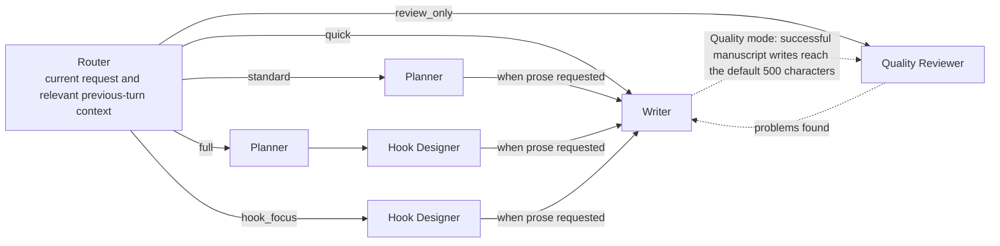

<!-- Last synced with README.md: 2026-10-15 -->

<p align="center">
  
</p>

<h1 align="center">ZenStory Workbench</h1>

<p align="center">
  <b>Chat to create: write fiction in your browser while the AI creates and edits your outlines, chapters and character sheets.</b>
</p>

<p align="center">
  <a href="https://zenstory.ai/workbench"><b>Project page</b></a>
  &nbsp;·&nbsp;
  <a href="#get-started"><b>Get started</b></a>
  &nbsp;·&nbsp;
  <a href="#see-what-it-produces"><b>See what it produces</b></a>
  &nbsp;·&nbsp;
  <a href="README.md"><b>中文</b></a>
</p>

<p align="center">
  <a href="https://github.com/zenstory-ai/zenstory/stargazers"></a>
  
  <a href="https://app.zenstory.ai/"></a>
  <a href="./LICENSE"></a>
</p>

<p align="center">
  <a href="https://app.zenstory.ai/"></a>
  <a href="https://github.com/zenstory-ai/zenstory/issues"></a>
</p>

> **Use the hosted app at [app.zenstory.ai](https://app.zenstory.ai/): sign up or sign in to start creating.**


The workspace puts the file tree on the left, the editor in the middle and AI chat on the right.

## What it is

ZenStory Workbench is a place to write fiction in the browser. Outlines, chapters, character sheets, settings and reference material are all files in a project. You talk to the AI on the right, and it creates and edits those files directly, with no copy-paste in between. Use it online at [app.zenstory.ai](https://app.zenstory.ai), or host it yourself under the MIT license.

- **Edit files from the chat**: ask for "a villain, brooding, with a tragic past" and the Agent creates a character sheet in the Characters folder, streaming it into the editor as it writes. Continuing or rewriting a chapter works the same way: the change lands in the file.
- **One router, four specialist agents**: the router uses your current request and relevant context from the previous turn to choose a workflow. The Planner, Hook Designer, Writer and Quality Reviewer work within your requested scope: an outline request stops at the outline. In Quality mode, automatic review normally starts when successful manuscript writes total 500 characters; chat and outlines do not count. The reviewer reads and reports, handing back only issues that need revision.
- **Version history for revisions**: AI edits from chat record versions and can be undone from the edit card. Consecutive editor saves coalesce into the latest manual version within a time window; later saves create a new one. Reaching the manual-version quota still allows the text to save. A normally completed AI turn also records a project snapshot.
- **Each turn carries the right material**: within a budget of about 32,000 tokens the AI gets the four AI Memory fields (Project Summary, Writing Style, Current Phase, Notes; long ones are shortened), the project's file list, the file you are editing, the previous chapter and a few recently edited files from the same folder, and recently edited characters and lore.
- **Other agents can plug in**: generate an API key in Settings, sign in with `npx zenstory login` and install the skill with `npx zenstory skill install`, and agents such as Claude Code, Codex or OpenClaw can read and write your projects.

## What's in the workbench

<table>
  <tr>
    <td></td>
    <td></td>
  </tr>
  <tr>
    <td align="center">A chapter open, with a request typed on the right</td>
    <td align="center">A novel project starts with five folders (Chinese UI shown; in English: World Building, Characters, Materials, Outlines, Drafts)</td>
  </tr>
</table>

### Multi-agent roles



| Path | Who works | When it runs |
| --- | --- | --- |
| quick | the Writer writes directly | everyday continuing and expanding; also the fallback when the router is unsure |
| standard | plan first; write prose only when requested | you ask for an outline, plan, synopsis or chapter structure |
| full | planning, hook design and writing within your requested scope | you explicitly ask for the full treatment, a key chapter or a climax |
| hook_focus | design payoffs, twists and pacing; revise prose when requested | you say it's flat, not satisfying enough, or needs a twist |
| review_only | review only, no edits | you ask for a check, an assessment or a read-on score |

The input box switches between Quality and Fast; both use the same model. Quality runs the router and automatically reviews successful manuscript writes at the configured length. Fast goes straight to the Writer and disables that automatic check. The writing prompt still requests a reviewer handoff for longer drafts, so review can also occur in Fast mode. Planning and revisions stay within your current request.

While the AI is working you can type a follow-up instruction. The agent that is running doesn't see it during its current run; when that run ends, the next agent picks it up, or, if none is planned, the same agent gets one more round to act on it. What is being written is not interrupted.

### 13 built-in skills

The product uses the Chinese skill names below, with English labels for reference.

| Category | Skills |
| --- | --- |
| Writing | 续写正文 `continue-writing` · 场景描写 `describe-scene` · 对话生成 `generate-dialogue` · 开头生成 `generate-opening` |
| Plot | 创建大纲 `create-outline` · 冲突设计 `design-conflict` · 钩子设计 `hook-design` · 反转设计 `reversal-design` |
| Style | 代入感强化 `immersion-enhance` · 润色修改 `polish-text` · 节奏控制 `rhythm-control` |
| Character | 创建角色 `create-character` |
| Worldbuilding | 世界观设定 `worldbuilding` |

Official skill descriptions and instructions live in the database; see [writing-guidance maintenance](docs/agent-writing-guidance.md). Add one under Skills → Discover. Each turn, the AI first sees the names and purposes of enabled skills and loads the full method when needed. Type `/` in chat or select a skill in the sidebar to attach it to a message, up to 3 at once.

Custom skills use the open Agent Skills `SKILL.md` format, optionally with `references/` resources, and can be imported or exported as `.zip` / `.md` packages. Scripts in imported packages are discarded with a warning. Shared skills become public after admin approval.

### Versions, snapshots and export


- Autosave runs about 3 seconds after you stop typing. By default, consecutive manual saves within 10 minutes coalesce into the latest manual version; later saves create a new version. Small edits are included too. AI edits record separate AI Edited versions and do not use the manual-version allowance.
- The History button at the bottom of the editor opens the current file's versions: compare any two line by line, or roll the file back. Rollback deletes no versions; while the file's version allowance has room, the restored text is recorded as a new version. Current prose that has not entered history is backed up before restoration; if that backup fails, restoration is cancelled. Preserve unsaved editor text first.
- The history icon in the top bar (tooltip: Version History) lists whole-project snapshots. Compare two snapshots, or roll the whole project back to one. A snapshot records file versions and structure; the server creates a pre-rollback snapshot before restoration. Whole-project restoration also removes later files absent from the target snapshot. Check the scope and preserve unsaved browser drafts first.
- Export Manuscript merges chapters and scripts into one TXT in chapter order. Export outline and text also includes outlines; character sheets and lore are outside both exports.

### Material library and inspiration library

- **Material library**: upload a reference novel as TXT (up to 300,000 characters) and by default the backend extracts per-chapter summaries, a whole-book synopsis, character profiles, the world setting, and cheat abilities (金手指, the protagonist's special edge). Per-chapter plot points and what is built on them (cross-chapter arcs and storylines, character relationships) are off by default; enable them with the `MATERIAL_ENABLE_*` flags (see `apps/server/.env.example`). Each chapter's full text is still sent twice, for the summary and for character extraction (three times with plot points on). The AI does not browse the library on its own; attach entries to the chat or import them into the project (see the [FAQ](#does-the-ai-consult-my-material-library-automatically)). On the hosted service, the full material library requires Pro. Where the free trial is enabled, the app offers a one-time trial and states the chapter limit; only those opening chapters are retained and analysed.
- **Inspiration library (optional, disabled by default)**: complete project templates, either published by the admins or submitted by users and approved by an admin. Once enabled, Use This Template creates a new project with a copy of every file. Set `INSPIRATIONS_ENABLED=true` on the server and `VITE_INSPIRATIONS_ENABLED=true` on the frontend, then restart the server and rebuild the frontend (restart Vite in development). Quick-start Docker only needs `INSPIRATIONS_ENABLED=true` followed by container recreation. Disabling it hides library entry points, featured templates, submissions and related benefits, and disables both user and admin APIs. Existing data and creating projects from your own ideas are unaffected.

### Also

- A project is a Long-form Novel, Short Story or Screenplay (short drama); each type has its own starter folders and its own writing brief for the AI.
- Import a manuscript you've already written; it is split into chapter files at the headings (see the [FAQ](#can-i-bring-in-a-manuscript-ive-already-written)).
- `Cmd+K` (`Ctrl+K` on Windows) searches file titles in the project.
- The chat box has voice input (Tencent Cloud ASR); the recognized text lands in the input box.
- Chinese and English interfaces; dark and light themes are switched in Settings; on a phone browser the workbench becomes three bottom tabs, Files / Editor / AI.

## Get started

### Hosted

Sign up at [app.zenstory.ai](https://app.zenstory.ai); a friend's invite code is optional. The free plan includes 3 AI messages a day (reset at 00:00 Beijing time) and up to 3 projects; the [pricing page](https://app.zenstory.ai/pricing) compares the plans.

Create a Short Story project. A good first request asks for an outline you can edit rather than a chapter (the example comes from the [quick start](https://zenstory.ai/docs/getting-started/quick-start#en); the English docs are below the Chinese on each page):

> Plan a realistic mystery short story as a three-scene outline only. Do not write prose or create or modify files. It is 5:40 p.m.; the station lost-property desk closes at six. Lin He handles Shen Min's claim for a gray canvas bag. She describes its exterior correctly but names the wrong object in its inner pocket. Do not conclude that she stole it or decide the truth. Lin He cannot release the bag on a verbal claim alone. For each scene, give the location, immediate goal, visible action, information change and closing question. End with two choices for me to decide, then stop.

Once the outline is settled, name the files and let it write (the third line needs the 钩子设计 skill added under Skills → Discover first):

```text
Save the three-scene outline as "Lost and Found outline" in the Concept folder.
Following "Lost and Found outline", write scene one as "Scene 1: The Claim" in the Drafts folder and stop after that scene.
钩子设计：rewrite only the last two paragraphs of "Scene 1: The Claim" so it ends on a stronger hook.
```

The [docs](https://zenstory.ai/docs#en) cover the rest.

### Self-hosted

You need Docker and a [DeepSeek API key](https://platform.deepseek.com/api_keys):

```bash
export DEEPSEEK_API_KEY=your-key          # or put it in a .env file at the repo root
docker compose up -d --build

# First account: an admin, no invite code or email verification.
# Use your own email and a password of 12+ characters (CHANGE-ME is too short and is rejected)
docker compose exec -e ZENSTORY_ADMIN_EMAIL=you@example.com \
  -e ZENSTORY_ADMIN_PASSWORD='CHANGE-ME' server python scripts/create_admin.py

# Project prompts live only in DB: configure novel, short and screenplay in admin, then reload.
# Official skills also live only in DB; maintenance: docs/agent-writing-guidance.md.
```

Sign in at <http://localhost:5173>; the API reference is at <http://localhost:8000/docs>. The database is SQLite and lives in a Docker volume together with uploads, so `docker compose down` and image rebuilds keep your data.

Every account, the admin included, starts on the free plan: 3 AI messages a day (reset at 00:00 Beijing time) and up to 3 projects. To lift that, run `docker compose exec server python scripts/seed_subscription_plans.py` to create the Pro plan (it also creates the free-plan row), then give an account Pro under Subscriptions in the admin console, or raise the free plan's limits under Subscription Plans.

The writing agents use DeepSeek `deepseek-flash` (DeepSeek-V4.1-Flash) by default and need only that key (an optional primary/backup setup is described under "Can I use a different model?"). Other features need their own settings. With the quick start above, add backend variables under `server.environment` in `docker-compose.yml` and `VITE_*` variables under `web.environment`, then run `docker compose up -d`; the repo-root `.env` only fills the `${…}` placeholders in the compose file (such as `DEEPSEEK_API_KEY` and `JWT_SECRET_KEY`) and passes nothing else into the containers. With `docker-compose.full.yml`, put them in `apps/server/.env.docker` and `apps/web/.env.docker` instead.

<details>
<summary>Settings for optional features</summary>

| Feature | Settings |
| --- | --- |
| Letting other people sign up | invite codes are required by default; an admin generates them under Settings → Referral. To drop them, set `AUTH_REGISTER_INVITE_CODE_OPTIONAL=true` |
| Verification codes for email sign-up | `REDIS_URL`, `RESEND_API_KEY`, `RESEND_FROM_EMAIL`; the quick start has no Redis, so use `docker-compose.full.yml` |
| Staying signed in across restarts | `JWT_SECRET_KEY` (32+ characters; with the quick start it can go in the root `.env`) |
| Voice input | `TENCENT_SECRET_ID`, `TENCENT_SECRET_KEY` |
| Google sign-in | backend `GOOGLE_CLIENT_ID`, `GOOGLE_CLIENT_SECRET`, `GOOGLE_REDIRECT_URI`, `FRONTEND_URL`; frontend `VITE_GOOGLE_OAUTH_ENABLED=true` |
| Material-library decomposition | a separate Prefect server and worker (see [`apps/server/prefect.yaml`](apps/server/prefect.yaml)), and the material library enabled on the plan |
| Connecting outside agents | `API_BASE_URL=https://your-server/api/v1` (the backend address, written into `/skill.md`). Settings derives `npx zenstory login --api-base <backend>/api/v1` and `<backend>/skill.md` from the frontend's `VITE_API_BASE_URL`; the CLI only accepts https, except for `localhost` / `127.0.0.1` |
| Redemption codes | `REDEMPTION_CODE_HMAC_SECRET` (32+ characters), with the Pro plan created first |
| Alipay checkout / renewal | backend `ZPAY_ENABLED=true`, `ZPAY_PID`, `ZPAY_KEY`, `ZPAY_NOTIFY_URL`, `ZPAY_RETURN_URL`, and optional `ZPAY_CID`; create the Pro plan and set its monthly / yearly prices first |

</details>

### Optional: Zpay Alipay checkout

Online payments are disabled by default. When enabled, Alipay purchases activate Pro for 30 days (monthly) or 365 days (yearly); renewing the same plan extends its expiry. Redemption codes remain a secondary option. Prices come from the backend plan configuration, and the admin Payment Orders page shows payment and fulfillment status.

Keep merchant credentials in backend environment variables only: never commit them or expose them through `VITE_*`. Set `ZPAY_NOTIFY_URL` to a publicly reachable backend HTTPS endpoint, such as `https://api.example.com/api/v1/payments/zpay/notify`, and `ZPAY_RETURN_URL` to the frontend `https://app.example.com/dashboard/billing/payment-return`. Neither URL may contain a preset query or fragment. Production notifications should reach the backend directly, without a frontend proxy.

Before enabling checkout, apply database migrations and verify that the `payment_order` table exists. Only a backend notification with a valid Zpay signature, merchant, amount and order can grant benefits; the browser return page cannot. To stop new checkouts, set `ZPAY_ENABLED=false` but retain credentials and the notification URL to process existing orders. See the [official Zpay protocol](https://zpayz.cn/doc.html).

<details>
<summary>Local development without Docker</summary>

You need Node.js 20.19+, Python 3.12 and pnpm:

```bash
# Terminal 1: backend (port 8000)
cd apps/server
python3 -m venv venv && source venv/bin/activate
pip install -r requirements.txt
cp .env.example .env          # set DEEPSEEK_API_KEY
python3 main.py

# Terminal 2: frontend (port 5173)
cd apps/web
pnpm install
cp .env.example .env.local
pnpm dev
```

Create the first account with `scripts/create_admin.py` as well (run it from `apps/server` with `ZENSTORY_ADMIN_EMAIL` and `ZENSTORY_ADMIN_PASSWORD` set). Optional settings go in `apps/server/.env` and `apps/web/.env.local`.

</details>

For PostgreSQL + Redis, more accounts, other ports and similar details, see [docs/docker-compose.md](docs/docker-compose.md) (in Chinese).

## See what it produces

The first section preserves historical examples of prose revision. The other two come from an API run: a clean checkout started with the [Self-hosted](#self-hosted) steps, then created a novel project called 失物招领 (Lost and Found) and wrote test chapters. The chapter text was entered without an AI call; omissions are marked "……".

### Historical prose-revision examples

These examples come from an [earlier writing prompt](https://github.com/zenstory-ai/zenstory/blob/bc780ae03ec95440f3277c992ad2c464a74ac49f/apps/server/agent/prompts/subagents.py). The original Chinese is preserved; the word-ban rule has since been replaced.

```markdown
### 禁用词汇
绝对禁止使用以下AI高频词汇：
- 仿佛、好像、犹如、一丝、一抹
- 深吸一口气、缓缓、不禁
……
### 正确替代示例
- ❌ '他感到一丝愤怒' → ✅ '他攥紧了拳头'
- ❌ '她的眼中闪过一抹惊讶' → ✅ '她愣了一下'
- ❌ '"你好。"他说道' → ✅ '"你好。"他点了点头'
```

The pairs compare generic emotion statements with visible reactions: "he felt a trace of anger" becomes "he clenched his fists"; "surprise flashed in her eyes" becomes "she froze for a second"; a bare "he said" becomes a gesture. The [current prompt](apps/server/agent/prompts/subagents.py) preserves meaning, viewpoint, clues, hooks and character voice, and fixes located problems rather than applying word bans or deletion targets. Length and endings follow the author's request and the work's form.

### Chapters sort by the number in the title, and export follows

Five files were created in the 正文 (Drafts) folder in this order: chapter ten, the prologue (序章), chapter 2, chapter one, chapter one hundred and two. The file tree returned:

```text
第一章 五点四十分
第2章 灰色帆布包
第十章 六点关门
序章
第一百零二章 尾声
```

Chinese and Arabic numerals mix fine. The prologue has no number, so it goes after whatever files existed when it was created, which put it after chapter ten; create it while the folder is still empty if you want it first (checked in a second project: prologue, chapter one, chapter 2).

Export Manuscript merges them into one TXT in the same order. It starts like this:

```text
第一章 五点四十分

五点四十分，林禾把登记簿翻到今天那一页。
沈敏说包是灰色的帆布包，内袋里有一把折叠伞。
窗口六点关。

---

第2章 灰色帆布包

第2章的正文。

---
……
```

### Connecting Claude Code

Create a key under Settings → Agent, then run this in your own terminal (Node.js 20+):

```bash
npx zenstory login           # paste the key at "Paste API key:" (hidden input, kept out of shell history)
npx zenstory skill install   # installs the skill for Claude Code; add --target codex / --target openclaw for others
npx zenstory whoami          # check login state and read/write scopes
```

If you self-host, add `--api-base https://your-server/api/v1` to the login command (Settings shows the command with it filled in). Don't paste the key into an AI chat; if you already did, regenerate it under Settings → Agent.

With the skill installed, the agent works through the ZenStory CLI (`zenstory`). The skill's workflow for continuing a chapter:

```bash
dir=$(mktemp -d)                                                             # temporary manuscript directory
zenstory files list <projectId> --type draft --fields id,title --json          # list drafts
zenstory context <projectId> --file <chapterId> --query "what happens next" --json   # relevant context
zenstory files get <chapterId> --fields updated_at --json                      # note updated_at
zenstory files get <chapterId> -o "$dir/<chapterId>.md"                        # into a mktemp -d directory
zenstory files put <chapterId> --content-file "$dir/<chapterId>.md" --if-updated-at <updated_at>   # write back
```

Other agents can read `https://api.zenstory.ai/skill.md` directly (English: `/skill.md?lang=en`) for the HTTP API.

Step 1 with that key returns the chapters above, in the file-tree order:

```json
{
 "files": [
  { "id": "9f079009-2732-4230-9d2c-2c9caf48d10a", "title": "第一章 五点四十分" },
  { "id": "76099953-a196-47c5-a38a-6e88c2632050", "title": "第2章 灰色帆布包" },
  ……
 ],
 "total": 5,
 "limit": 50,
 "offset": 0
}
```

The agent writes with its own model; ZenStory stores the manuscript and assembles context. `files put` replaces the whole file, so it is guarded: it refuses when you edited the file in the browser meanwhile (`updated_at` changed), requires `--allow-shrink` when the new text is under half the old length, and the server records a version in the history (when the per-file version quota is used up, the content is still saved without a version) — undo a bad write with `zenstory files versions <chapterId>` and `zenstory files rollback <chapterId> <n> --yes`. As a second net, the previous server copy is also saved to `~/.cache/zenstory/backups/` before writing. Projects created from the CLI get the same default folders as in the web app, and `--order` puts new chapters in place.

## FAQ

### Do I need an invite code to sign up on the hosted app?

No. Sign up at app.zenstory.ai; a friend's invite code is optional. Anyone with an account can click Generate Code under Settings → Referral: up to 3 codes per person, each usable 3 times. The shared link looks like `https://app.zenstory.ai/register?code=XXXX-XXXX` and fills the code in for you.

### On my own server, how do I create the first account, and how do others sign up?

Create the first account with `scripts/create_admin.py`; the command is under [Self-hosted](#self-hosted), and it needs neither an invite code nor email verification. Others need an invite code by default, which an admin generates under Settings → Referral or on the admin console's Referral System page. To drop invite codes, add `AUTH_REGISTER_INVITE_CODE_OPTIONAL: "true"` under `server.environment` in `docker-compose.yml` (in `apps/server/.env` for local development) and run `docker compose up -d`; optionally add `VITE_INVITE_CODE_OPTIONAL: "true"` under `web.environment` so the form shows the code as optional from the start ([#1](https://github.com/zenstory-ai/zenstory/issues/1)). People who sign up by email must receive a verification code before they can sign in, which needs Redis and `RESEND_API_KEY`.

For a few people you trust, you can also run `create_admin.py` again with their email and a new `ZENSTORY_ADMIN_USERNAME` (the default is `admin`; usernames must be unique). Every account made this way is an admin that can open the admin console and change prompts, plans and users; afterwards, edit the account under User Management and clear Superuser.

### Can I use a different model?

Environment variables choose a primary and a backup between DeepSeek and MiniMax, each with its own model name: `LLM_PRIMARY_PROVIDER` / `LLM_PRIMARY_MODEL`, `LLM_BACKUP_PROVIDER` / `LLM_BACKUP_MODEL`, with keys in `DEEPSEEK_API_KEY` and `MINIMAX_API_KEY`. When the primary is unavailable (connection failure, timeout, rate limit, 5xx, invalid key), that chat window switches to the backup. See [`apps/server/agent/core/llm_providers.py`](apps/server/agent/core/llm_providers.py); a new model needs a price in `apps/server/services/usage/pricing.py` first.

### Can I export to Word, or publish straight to a web-novel platform?

Neither. Export Manuscript produces one TXT: UTF-8 with a BOM, so Windows Notepad opens it directly, named `<project>_正文.txt`. For other formats, lay out that TXT in a local app; publishing to a platform is also a manual upload ([#13](https://github.com/zenstory-ai/zenstory/issues/13)).

### Does the AI ask before it changes my manuscript? How do I undo a bad edit?

It doesn't ask. Edits the Agent makes from chat are saved straight to the file, along with an AI Edited version. The edit card in chat lists each change with before/after snippets, and Undo returns the file to the previous version; you can also open History at the bottom of the editor and roll the file back to any version. If you only want to discuss, say "don't create or change any files" in the request; a request classified as read-only is also blocked from calling file-write tools. Check the reply to confirm that the requested scope was followed. Selecting text in the editor and choosing Humanize works differently: the rewrite opens as a paragraph-by-paragraph diff, and it is saved only after you accept or reject each change.

### In a long chat, does the AI still remember what I said at the start?

Not from the chat history. Only the most recent ~32,000 tokens of conversation go to the model each turn; older messages are dropped, not summarized, and files read or edited in the last turn or two are attached in full at their current version (within a cap). Project material has a separate budget of about 32,000 tokens: AI Memory, the project's file list, the current file, the previous chapter and a few recently edited files from the same folder, and recently edited characters and lore; a long Project Summary or Notes is shortened, and a large project's file list is cut off. Keep lasting points short in AI Memory and put the details in character and lore files. Confirm lasting requirements in AI Memory. AI updates to Notes remain proposals, while confirmed and existing entries are preserved; check the panel for the saved state.

### What's the difference between Fast and Quality mode?

Both use the same model. Fast skips routing and length-triggered automatic review; Quality assigns roles within your request and checks manuscript writes (see [Multi-agent roles](#multi-agent-roles)). Review prioritizes your requirements, continuity and causality rather than a mandatory subjective score. Each request allows at most two review rounds, then stops automatic rework.

### Does the AI consult my material library automatically?

No. To let it read an entry, use Attach to Chat in the project's Novel References panel (up to 5 entries per message), or import it into the project as a file; imported files can be searched like any other project file.

### What does the free plan include?

Hosted free plan: 3 AI messages a day (reset at 00:00 Beijing time, UTC+8), up to 3 projects, 10 manual-version slots per file (text still saves after the quota, and eligible consecutive saves can still coalesce), TXT export and up to 3 custom skills. The full Materials Library requires Pro. The app shows a one-time free trial and its scope where enabled. The free plan does not expire. Inline suggestions don't count toward daily AI messages.

### Can I bring in a manuscript I've already written?

Yes. Hover over the Drafts folder and click its + button (Upload Draft): up to 20 .txt or .md files at a time, each up to 5 MB and 500,000 characters. When a file has two or more chapter headings, it is split into separate chapter files at headings such as 第X章, 卷X, 序章, 楔子, 番外 and Chapter N.

### I forgot my password.

There is no self-service reset on the hosted app. Email support@zenstory.ai from the address you registered with.

## Further reading

- [Quick start](https://zenstory.ai/docs/getting-started/quick-start#en): from an empty project to a first outline you can edit.
- [Your first short story](https://zenstory.ai/docs/getting-started/first-project#en): an original short story's file plan and three scoped requests.
- [AI assistant](https://zenstory.ai/docs/user-guide/ai-assistant#en): focused files, quotes, and picking up after an interruption.
- [AI Memory](https://zenstory.ai/docs/advanced/ai-memory#en): what to put in the four fields and how to correct them.
- [Version history](https://zenstory.ai/docs/user-guide/version-history#en): restoring one file versus a whole-project snapshot.
- [From a reference passage to your own scene](https://zenstory.ai/docs/advanced/material-analysis#en): after analysing a reference novel, how to write a scene of your own.
- [Writing environments compared](https://zenstory.ai/compare/writing-workflows): plain chat, the Oh Story skill pack, the DSH plugin and ZenStory Workbench, and what each suits.
- [Keeping your voice when AI continues](https://zenstory.ai/oh-story/preserve-author-voice): describe your voice in concrete terms and give a short sample of your own.

## Contributing

- **GitHub Issues**: [report a bug](https://github.com/zenstory-ai/zenstory/issues/new?template=bug_report.md) · [request a feature](https://github.com/zenstory-ai/zenstory/issues/new?template=feature_request.md). In the hosted app you can also use the "…" menu at the top right of the project page → Feedback, which can attach a screenshot.
- Read [CONTRIBUTING.md](CONTRIBUTING.md) before changing code. The multi-agent workflow, tools and SSE events are described in [`apps/server/agent/AGENTS.md`](apps/server/agent/AGENTS.md).

<details>
<summary>Project layout and tech stack</summary>

```
zenstory/
├── apps/web/                 # React frontend
│   ├── src/components/       #   Layout, sidebar/FileTreePane, Editor, ChatPanel, skills …
│   ├── src/pages/            #   Dashboard, project, materials, pricing …
│   └── docs/                 #   docs source, published to zenstory.ai/docs
└── apps/server/              # FastAPI backend
    ├── api/                  #   routes: auth, projects, files, agent, agent_api, materials, admin …
    ├── agent/                #   the writing agents
    │   ├── graph/            #     orchestration loop: routing, handoffs, auto-review
    │   ├── tools/            #     file, project, skill and handoff tools
    │   ├── context/          #     per-turn context assembly, budget and priorities
    │   ├── prompts/          #     shared protocols and role prompts; project writing configuration is in DB
    │   └── skills/           #     skill loading and injection; official instructions live in DB
    ├── flows/                #   material decomposition pipeline (Prefect)
    ├── services/             #   business logic
    └── models/               #   data models
```

| Layer | Technologies |
| --- | --- |
| Frontend | React 19 · TypeScript · Vite 7 · Tailwind CSS 4 · Zustand · TanStack Query |
| Backend | FastAPI · SQLModel · Server-Sent Events |
| AI | DeepSeek `deepseek-flash` (DeepSeek-V4.1-Flash, OpenAI-compatible API) · openai-agents-python |
| Retrieval | Database keyword search with snippets and line numbers; edits are searchable immediately, without indexing |
| Data | SQLite (default) / PostgreSQL · Redis · Alembic |
| Deploy | Docker Compose; the hosted app runs the frontend on Vercel and the API plus Prefect on Railway |

</details>

## License

[MIT License](LICENSE) &copy; 2024-2026 ZenStory

## Part of ZenStory AI

ZenStory Workbench is maintained by [ZenStory AI](https://zenstory.ai) — open-source, agent-native tools for creating, adapting and producing stories (GitHub org: [zenstory-ai](https://github.com/zenstory-ai)). Sibling projects:

| Project | What it does |
| --- | --- |
| [oh-story-claudecode](https://github.com/zenstory-ai/oh-story-claudecode) | Web-fiction writing skill pack: chart scanning, deconstruction, drafting, de-AI-flavor, covers |
| [drama-skills](https://github.com/zenstory-ai/drama-skills) | AI short-drama / motion-comic suite: scripts, assets, storyboards, image & video prompts, review |
| [novel-to-game](https://github.com/zenstory-ai/novel-to-game) | Agent skills for source-grounded novel adaptation, target-runtime builds, and evidence-based QA |
| [video-recap-skills](https://github.com/zenstory-ai/video-recap-skills) | Create Chinese-narration recaps from supported video files, with optional editable JianYing/CapCut draft export |
| [oh-story-dsh](https://github.com/zenstory-ai/oh-story-dsh) | Community DeepSeek Harness plugin with novel, short-drama, game and video-recap workbenches |
| [zenstory](https://github.com/zenstory-ai/zenstory) | Chat-to-create AI novel-writing workbench, hosted at [app.zenstory.ai](https://app.zenstory.ai) (this repo) |
