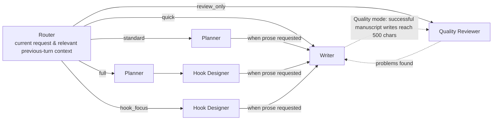

<!-- Last synced with README.md: 2026-11-09 -->

<p align="center">
  
</p>

<h1 align="center">ZenStory Workbench</h1>

<p align="center">
  <b>Chat to create: write fiction and short dramas in your browser while the AI creates and edits your outlines, chapters and character sheets.</b>
</p>

<p align="center">
  <a href="https://zenstory.ai/workbench"><b>Project page</b></a>
  &nbsp;·&nbsp;
  <a href="#get-started"><b>Get started</b></a>
  &nbsp;·&nbsp;
  <a href="#core-features"><b>Core features</b></a>
  &nbsp;·&nbsp;
  <a href="README.md"><b>中文</b></a>
</p>

<p align="center">
  <a href="https://github.com/zenstory-ai/zenstory/stargazers"></a>
  
  <a href="https://app.zenstory.ai/"></a>
  <a href="./LICENSE"></a>
</p>

<p align="center">
  <a href="https://app.zenstory.ai/"></a>
  <a href="https://github.com/zenstory-ai/zenstory/issues"></a>
</p>

> **Use the hosted app at [app.zenstory.ai](https://app.zenstory.ai/): sign up or sign in to start creating.**


The workspace puts the file tree on the left, the editor in the middle and AI chat on the right.

## What it is

ZenStory Workbench is a file-centred AI writing environment for **long-form novels, short stories and short-drama screenplays**. Outlines, chapters, character sheets, worldbuilding lore and reference materials live as structured files in your project. You talk to the AI on the right, and it creates or edits those files directly, streaming changes into the editor without copy-pasting between a chat window and a word processor. Use it online at [app.zenstory.ai](https://app.zenstory.ai), or self-host it under the AGPL-3.0 license.

- **Direct file streaming that respects author edits**: the Agent streams prose straight into project files with one-click undo cards in chat; manual edits you make in the editor are passed to the AI as `<author_edits>` net diffs, and author-saved manuscripts are protected against accidental deletion or full overwrite from chat.
- **Purpose-built multi-agent orchestration & scope guards**: a structured router coordinates the Planner, Hook Designer, Writer and Quality Reviewer. An outline request stops at the outline; prose is written only when requested, and in Quality mode manuscript writes automatically go through review and emit a single consolidated summary.
- **Web-fiction & short-drama native craft**: built-in genre norms keep openings in immediate conflict, deliver concrete payoffs on screen, drive dialogue through active stakes, and land chapter-end cliffhangers; selecting text in the editor and clicking **Humanize** opens a paragraph-by-paragraph diff for selective acceptance.
- **Cache-stable context snapshots & cross-turn working set**: each turn assembles AI Memory, a cross-turn working set (full text of recently read or edited files), adjacent chapters, and relevant character/lore sheets within dual ~32,000-token budgets, pinning stable material in `<project_snapshot>` to maximize LLM prompt-cache hits.
- **Open Agent Skills ecosystem & CLI integration**: ships with 14 progressively loaded official writing skills, imports/exports standard `SKILL.md` packages, and lets external agents like Claude Code, Codex and OpenClaw read and write your projects via `npx zenstory`.

## Get started

### Hosted

Sign up at [app.zenstory.ai](https://app.zenstory.ai) to start creating. Create a **Long-form Novel** project — a good first request asks the AI to plan a three-chapter opening outline before writing prose:

> I want to write a xianxia web novel. Plan a three-chapter opening outline first and do not write prose yet. The protagonist Xiao Wuya runs the largest merchant guild across the realms and has spent ten years funding Empress Luo Qinghan's rise with spirit stones, top-grade pills and mountain-warding arrays. At her ascension ceremony, to favor her new sword-prodigy favorite Ye Chen, she publicly mocks Xiao Wuya as reeking of copper coins and banishes him from the sect. Unbothered, Xiao Wuya immediately cuts off all spirit stone, pill and array supplies to her sect. Give the core conflict, reversal payoff and cliffhanger hook for each of the first three chapters.

Once the outline is settled, name the target files and let the AI write (the third line uses the Design Hooks skill, stored as `钩子设计`, added under **Skills → Discover** first):

```text
Save the three-chapter outline in the Outlines folder as "Opening 3-Chapter Outline".
Following "Opening 3-Chapter Outline", write chapter one as "Chapter 1: Reeking of Copper? Then I Cut Off Your Path to Immortality" in the Drafts folder and stop after that chapter.
钩子设计：rewrite only the last two paragraphs of Chapter 1 so it ends right as the sect's grand array drains to zero and the elders freeze in panic.
```

See the [user documentation](https://zenstory.ai/docs#en) for more workflows.

### Self-hosted

```bash
export DEEPSEEK_API_KEY=your-key          # or place it in .env at the repository root
docker compose up -d --build

# Create the first admin account (no invite code or email verification required; password must be 12+ chars)
docker compose exec -e ZENSTORY_ADMIN_EMAIL=you@example.com \
  -e ZENSTORY_ADMIN_PASSWORD='CHANGE-ME-12CHARS' server python scripts/create_admin.py
```

Sign in at <http://localhost:5173>; the API reference is at <http://localhost:8000/docs>. By default the app uses SQLite stored in a Docker volume alongside uploaded files, so `docker compose down` and image rebuilds preserve your data.

- **Writing configuration**: project system prompts (`novel`, `short`, `screenplay`) and official skills live in the database. Configure and reload them in the admin console after first launch; see [docs/agent-writing-guidance.md](docs/agent-writing-guidance.md).
- **Plan seeding**: run `docker compose exec server python scripts/seed_subscription_plans.py` to initialize plans, then assign Pro under **Subscriptions** in the admin console.
- **Production deployment & optional features**: for PostgreSQL + Redis setup, optional invite codes, email verification and password reset (Resend), primary/backup model failover (DeepSeek / MiniMax), Google sign-in, Tencent Cloud voice input, material-library Prefect workers, the Inspiration Library, and Zpay Alipay checkout, see [docs/docker-compose.md](docs/docker-compose.md) (in Chinese).

<details>
<summary>Local development without Docker</summary>

Requires Node.js 20.19+, Python 3.12 and pnpm:

```bash
# Terminal 1: backend (port 8000)
cd apps/server
python3 -m venv venv && source venv/bin/activate
pip install -r requirements.txt
cp .env.example .env          # set DEEPSEEK_API_KEY
python3 main.py

# Terminal 2: frontend (port 5173)
cd apps/web
pnpm install
cp .env.example .env.local
pnpm dev
```

Create the first admin account from `apps/server` by running `python scripts/create_admin.py` with `ZENSTORY_ADMIN_EMAIL` and `ZENSTORY_ADMIN_PASSWORD` set.

</details>

### Connect external agents (Claude Code / Codex / OpenClaw)

Create an API key under **Settings → Agent**, then run in your terminal (Node.js 20+):

```bash
npx zenstory login           # paste the key when prompted (hidden input; add --api-base https://your-server/api/v1 if self-hosted)
npx zenstory skill install   # installs for Claude Code by default; add --target codex or --target openclaw for others
npx zenstory whoami          # verify login status and read/write scopes
```

Once installed, the external agent writes with its own model while using the `zenstory` CLI to fetch assembled project context and save chapters back:

```bash
dir=$(mktemp -d)
zenstory files list <projectId> --type draft --fields id,title --json                # list drafts
zenstory context <projectId> --file <chapterId> --query "what happens next" --json   # fetch assembled project context
zenstory files get <chapterId> --fields updated_at --json                            # record current timestamp token
zenstory files get <chapterId> -o "$dir/<chapterId>.md"                              # download chapter to a temp file
zenstory files put <chapterId> --content-file "$dir/<chapterId>.md" --if-updated-at <updated_at>   # write back with lock check
```

See [apps/cli/README.md](apps/cli/README.md) and <https://api.zenstory.ai/skill.md?lang=en> for the full CLI and HTTP reference.

## Core features

<table>
  <tr>
    <td></td>
    <td></td>
  </tr>
  <tr>
    <td align="center">A chapter open, with a request typed on the right</td>
    <td align="center">A novel project starts with five folders (World Building, Characters, Materials, Outlines, Drafts)</td>
  </tr>
</table>

### Multi-agent orchestration and runtime guards



| Path | Who works | When it runs |
| --- | --- | --- |
| `quick` | Writer directly | Everyday continuation and expansion; also the fallback when routing is uncertain |
| `standard` | Planner first; Writer only if prose is requested | Outlines, plans, synopses or chapter structures |
| `full` | Planner → Hook Designer → Writer | Full workflow requests, key chapters or climaxes |
| `hook_focus` | Hook Designer first; Writer when revision is requested | Strengthening payoffs, twists or pacing |
| `review_only` | Quality Reviewer only (read-only) | Continuity checks, evaluations or read-on assessments |

- **Fast vs. Quality mode**: both use the same model. **Fast** skips length-triggered auto-review for rapid drafting. **Quality** triggers automatic review once successful manuscript writes reach 500 characters — checking author requirements, continuity and causality (up to two review rounds per request) while holding intermediate chatter so you receive a single consolidated summary.
- **In-flight steering & resumable long runs**: send follow-up instructions while the AI is generating — the running agent finishes its turn uninterrupted, and the next agent in line (or one extra round of the current agent) picks up the instruction. Long tasks approaching the wall-clock deadline wrap up cleanly with a resumable progress card, and options offered at the end of an AI reply automatically appear as one-click suggestion chips above the input box.

### Context snapshots, working set and AI Memory

- **Dual ~32,000-token budgets & priority tiers**: each turn sends the most recent ~32,000 tokens of conversation and the cross-turn working set (full text of files read or edited in the last two turns, up to 8 files / 60,000 chars) alongside a separate ~32,000-token budget assembled by priority: focused file & quotes → character sheets, core lore & previous chapter → sibling chapters & live keyword search snippets.
- **Prompt-cache stable prefix**: relatively stable project material is rendered into `<project_snapshot>` right after the system prompt, while turn-specific updates and the active chapter travel in `<turn_context>`, maximizing prompt-cache reuse across turns and agent handoffs.
- **AI Memory & Writing Conventions**: structured into four fields (Project Summary, Writing Style, Current Phase, Writing Conventions). When you explicitly ask the AI in chat to remember a rule (e.g. "Remember: the heroine doesn't appear until Chapter 5"), it appends the entry to Writing Conventions without altering your existing notes and shows a receipt card in chat.

### 14 built-in skills and custom skill packages

The app shows these English names in the English interface; the Chinese names are what the Chinese interface shows.

| Category | Built-in skills |
| --- | --- |
| Writing | Continue the Draft 续写正文 · Write an Opening 开头生成 · Write a Short Story 短篇写作 · Write Short-Drama Episodes 短剧剧本正文生成 |
| Plot | Create an Outline 创建大纲 · Design Hooks 钩子设计 · Short-Drama Adaptation Analysis 短剧改编分析 · Short-Drama Synopsis 短剧故事概要生成 · Short-Drama Episode Outlines 短剧分集集纲生成 |
| Style | Polish Prose 润色修改 · Control Pacing 节奏控制 · Remove AI Tone 去AI味 |
| Character | Create a Character 创建角色 |
| Worldbuilding | Build the World 世界观设定 |

Enable skills under **Skills → Discover**. Each turn, the AI sees the L1 catalog (names and purposes of enabled skills) and progressively loads L2 instructions and L3 reference files on demand; you can also type `/` in chat or pick skills from the sidebar to attach up to 3 directly to a message. Custom skills follow the open Agent Skills `SKILL.md` specification and can be imported or exported as `.zip` or `.md` packages (executable scripts are stripped on import).

### Reference novel deconstruction & resilient model routing

- **Reference Novel Material Library**: backed by a Prefect pipeline, upload a reference novel as TXT (up to 300,000 characters) to extract per-chapter summaries, a whole-book synopsis, character profiles, worldbuilding settings and protagonist edges (金手指). Attach entries to chat (up to 5 per message) or import them into your project as searchable files.
- **DeepSeek / MiniMax failover & weighted dual-key routing**: configure primary and backup providers between DeepSeek and MiniMax (pre-output instant failover, session pinning to preserve prompt caches, and circuit breaking), plus weighted primary/secondary API key routing with per-key cooldowns for MiniMax. Stream billing automatically refunds the turn if a run is stopped, times out, or fails before producing substantive prose.

## FAQ

### How do I discuss ideas with the AI without letting it edit my files?

Include "do not create or modify files" in your prompt — when the router classifies a request as read-only, all file-write tools are blocked. If the AI already edited a file, click **Undo** on the edit card in chat or roll back from **History** at the bottom of the editor.

### Can I use a different model?

Self-hosted deployments can configure primary and backup providers between DeepSeek and MiniMax via environment variables: `LLM_PRIMARY_PROVIDER` / `LLM_PRIMARY_MODEL`, `LLM_BACKUP_PROVIDER` / `LLM_BACKUP_MODEL`, with keys in `DEEPSEEK_API_KEY` and `MINIMAX_API_KEY` (plus optional `MINIMAX_SECONDARY_API_KEY` weighted routing). See [`apps/server/agent/core/llm_providers.py`](apps/server/agent/core/llm_providers.py) (new models require a price entry in `apps/server/services/usage/pricing.py`).

### Can I export to Word or publish directly to web-novel platforms?

**Export Manuscript** merges chapters and scripts in chapter order into a single UTF-8 with BOM `.txt` file (`<project>_正文.txt`), and individual outlines or lore files can be saved via **Download current file**. For Word formatting or platform publishing, import the exported TXT into your local word processor or upload it manually ([#13](https://github.com/zenstory-ai/zenstory/issues/13)).

### How do I disable invite codes when self-hosting?

Self-hosted instances require an invite code by default (generated on the admin console's **Referral System** page). To allow open sign-ups without an invite code, set `AUTH_REGISTER_INVITE_CODE_OPTIONAL=true` on the backend (and optionally `VITE_INVITE_CODE_OPTIONAL=true` on the frontend); see [docs/docker-compose.md](docs/docker-compose.md) ([#1](https://github.com/zenstory-ai/zenstory/issues/1)).

## Further reading

- [Quick start](https://zenstory.ai/docs/getting-started/quick-start#en): from an empty project to a first outline you can edit.
- [Your first short story](https://zenstory.ai/docs/getting-started/first-project#en): an original short story's file plan and three scoped requests.
- [AI assistant](https://zenstory.ai/docs/user-guide/ai-assistant#en): focused files, quotes, and picking up after an interruption.
- [AI Memory](https://zenstory.ai/docs/advanced/ai-memory#en): what to put in the four fields and how to correct them.
- [Version history](https://zenstory.ai/docs/user-guide/version-history#en): view, compare and restore one file's versions.
- [From a reference passage to your own scene](https://zenstory.ai/docs/advanced/material-analysis#en): after analysing a reference novel, how to write a scene of your own.
- [Writing environments compared](https://zenstory.ai/compare/writing-workflows): plain chat, the Oh Story skill pack, the DSH plugin and ZenStory Workbench, and what each suits.
- [Keeping your voice when AI continues](https://zenstory.ai/oh-story/preserve-author-voice): describe your voice in concrete terms and give a short sample of your own.

## Contributing

- **GitHub Issues**: [report a bug](https://github.com/zenstory-ai/zenstory/issues/new?template=bug_report.md) · [request a feature](https://github.com/zenstory-ai/zenstory/issues/new?template=feature_request.md). In the hosted app you can also use the **…** menu at the top right of the project page → **Feedback** to attach a screenshot.
- Read [CONTRIBUTING.md](CONTRIBUTING.md) and the repository documentation index [docs/en/README.md](docs/en/README.md) before changing code. The multi-agent workflow, tools and SSE events are documented in [`apps/server/agent/AGENTS.md`](apps/server/agent/AGENTS.md).

<details>
<summary>Project layout and tech stack</summary>

```text
zenstory/
├── apps/web/                 # React frontend
│   ├── src/components/       #   Layout, sidebar/FileTreePane, Editor, ChatPanel, skills …
│   ├── src/pages/            #   Dashboard, project, materials, pricing …
│   └── docs/                 #   docs source, published to zenstory.ai/docs
├── apps/cli/                 # zenstory CLI and external Agent Skill package
└── apps/server/              # FastAPI backend
    ├── api/                  #   routes: auth, projects, files, agent, agent_api, materials, admin …
    ├── agent/                #   the writing agents
    │   ├── graph/            #     orchestration loop: routing, handoffs, auto-review
    │   ├── tools/            #     file, project, skill and handoff tools
    │   ├── context/          #     context snapshots, token budgets and priority tiers
    │   ├── prompts/          #     shared protocols, web-fiction/drama genre norms and role prompts
    │   └── skills/           #     progressive skill loading and injection
    ├── flows/                #   material decomposition pipeline (Prefect)
    ├── services/             #   business logic and stream billing ledger
    └── models/               #   data models
```

| Layer | Technologies |
| --- | --- |
| Frontend | React 19 · TypeScript · Vite 7 · Tailwind CSS 4 · Zustand · TanStack Query |
| Backend | FastAPI · SQLModel · Server-Sent Events |
| AI | DeepSeek / MiniMax failover & weighted dual-key routing · openai-agents-python |
| Retrieval | Database keyword search with snippets and line numbers; edits are searchable immediately, without indexing |
| Data | SQLite (default) / PostgreSQL · Redis · Alembic |
| Deploy | Docker Compose; the hosted app runs the frontend on Vercel and the API plus Prefect on Railway |

</details>

## License

[GNU AGPL-3.0](LICENSE) &copy; 2024-2026 ZenStory

This repository is licensed under the GNU Affero General Public License v3.0. You may use, modify and self-host it; if you offer a modified version to others as a network service, the AGPL requires you to make the corresponding source available to those users.

The ZenStory name and logo are not licensed: forks and self-hosted services should use their own name. For a commercial license without the AGPL obligations, contact the maintainers.

The `apps/cli` command-line client stays under the MIT license; see [apps/cli/LICENSE](apps/cli/LICENSE).

## Part of ZenStory AI

ZenStory Workbench is maintained by [ZenStory AI](https://zenstory.ai) — open-source, agent-native tools for creating, adapting and producing stories (GitHub org: [zenstory-ai](https://github.com/zenstory-ai)). Sibling projects:

| Project | What it does |
| --- | --- |
| [oh-story-claudecode](https://github.com/zenstory-ai/oh-story-claudecode) | Web-fiction writing skill pack: chart scanning, deconstruction, drafting, de-AI-flavor, covers |
| [drama-skills](https://github.com/zenstory-ai/drama-skills) | AI short-drama / motion-comic suite: scripts, assets, storyboards, image & video prompts, review |
| [novel-to-game](https://github.com/zenstory-ai/novel-to-game) | Agent skills for source-grounded novel adaptation, target-runtime builds, and evidence-based QA |
| [video-recap-skills](https://github.com/zenstory-ai/video-recap-skills) | Create Chinese-narration recaps from supported video files, with optional editable JianYing/CapCut draft export |
| [oh-story-dsh](https://github.com/zenstory-ai/oh-story-dsh) | Community DeepSeek Harness plugin with novel, short-drama, game and video-recap workbenches |
| [zenstory](https://github.com/zenstory-ai/zenstory) | Chat-to-create AI novel-writing workbench, hosted at [app.zenstory.ai](https://app.zenstory.ai) (this repo) |
