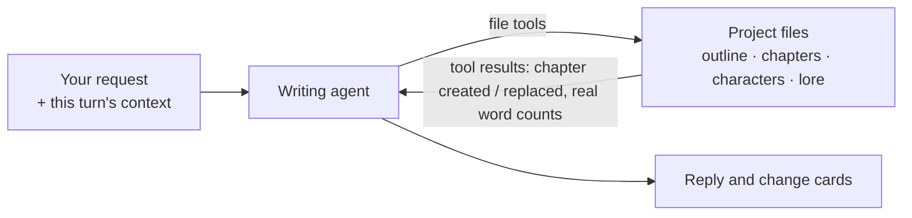

<!-- Last synced with README.md: 2026-11-19 -->

<p align="center">
  
</p>

<h1 align="center">ZenStory Workbench</h1>

<p align="center">
  <b>Chat to create: write fiction and short dramas in your browser while the AI creates and edits your outlines, chapters and character sheets.</b>
</p>

<p align="center">
  <a href="https://zenstory.ai/workbench"><b>Project page</b></a>
  &nbsp;·&nbsp;
  <a href="#get-started"><b>Get started</b></a>
  &nbsp;·&nbsp;
  <a href="#core-features"><b>Core features</b></a>
  &nbsp;·&nbsp;
  <a href="README.md"><b>中文</b></a>
</p>

<p align="center">
  <a href="https://github.com/zenstory-ai/zenstory/stargazers"></a>
  
  <a href="https://app.zenstory.ai/"></a>
  <a href="./LICENSE"></a>
</p>

<p align="center">
  <a href="https://app.zenstory.ai/"></a>
  <a href="https://github.com/zenstory-ai/zenstory/issues"></a>
</p>

> **Use the hosted app at [app.zenstory.ai](https://app.zenstory.ai/): sign up or sign in to start creating.**


The workspace puts the file tree on the left, the editor in the middle and AI chat on the right.

## What it is

ZenStory Workbench is a browser workspace for writing **long-form novels, short stories and short-drama screenplays**. Outlines, chapters, character sheets, worldbuilding lore and reference materials are all files in your project; talk to the AI on the right, and it creates or edits those files directly without copy-pasting between a chat window and a word processor. Use it online at [app.zenstory.ai](https://app.zenstory.ai), or self-host it under the AGPL-3.0 license.

- **Direct file edits that respect your own revisions**: ask for a new character sheet, outline or chapter in chat and the agent streams it straight into the editor, with one-click undo on the chat card. Anything you edit by hand is synced back to the AI so continuations build on your changes, and saved manuscripts cannot be deleted or overwritten wholesale from chat.
- **One agent, start to finish**: a single writing agent reads your project, plans, writes and checks continuity, doing only what this turn asks for — ask for an outline and it stops at the outline; ask for prose and it writes the chapter. Chapters are written by number, so writing chapter 3 changes only chapter 3, and word counts in replies come from what was actually saved.
- **Paced for web fiction and short dramas**: openings start inside the conflict, payoffs land on screen, dialogue drives the stakes, and chapters end on a hook. Select any passage in the editor and click **Humanize** to review paragraph-by-paragraph rewrites and accept only the lines you want.
- **Long-form continuity without digging through chat history**: each turn automatically brings in AI Memory, the full text of chapters you just read or edited, the previous chapter, and relevant character and lore sheets.
- **14 built-in skills, plus external agent support**: ships with 14 skills for continuation, hooks, short stories, short-drama episodes and prose polishing, and imports or exports standard `SKILL.md` packages. With the `npx zenstory` CLI, external agents like Claude Code, Codex and OpenClaw can also read and write your project files.

## Get started

### Hosted

Sign up at [app.zenstory.ai](https://app.zenstory.ai) to start creating. Create a **Long-form Novel** project — a good first request asks the AI to plan a three-chapter opening outline before writing prose:

> I want to write a xianxia web novel. Plan a three-chapter opening outline first and do not write prose yet. The protagonist Xiao Wuya runs the largest merchant guild across the realms and has spent ten years funding Empress Luo Qinghan's rise with spirit stones, top-grade pills and mountain-warding arrays. At her ascension ceremony, to favor her new sword-prodigy favorite Ye Chen, she publicly mocks Xiao Wuya as reeking of copper coins and banishes him from the sect. Unbothered, Xiao Wuya immediately cuts off all spirit stone, pill and array supplies to her sect. Give the core conflict, reversal payoff and cliffhanger hook for each of the first three chapters.

Once the outline is settled, name the target files and let the AI write (the third line uses the Design Hooks skill, stored as `钩子设计`, enabled under **Skills → Discover** first):

```text
Save the three-chapter outline in the Outlines folder as "Opening 3-Chapter Outline".
Following "Opening 3-Chapter Outline", write chapter one as "Chapter 1: Reeking of Copper? Then I Cut Off Your Path to Immortality" in the Drafts folder and stop after that chapter.
钩子设计：rewrite only the last two paragraphs of Chapter 1 so it ends right as the sect's grand array drains to zero and the elders freeze in panic.
```

See the [user documentation](https://zenstory.ai/docs#en) for more workflows.

### Self-hosted

```bash
export DEEPSEEK_API_KEY=your-key          # or place it in .env at the repository root
docker compose up -d --build

# Create the first admin account (no invite code or email verification required; password must be 12+ chars)
docker compose exec -e ZENSTORY_ADMIN_EMAIL=you@example.com \
  -e ZENSTORY_ADMIN_PASSWORD='CHANGE-ME-12CHARS' server python scripts/create_admin.py
```

Sign in at <http://localhost:5173>; the API reference is at <http://localhost:8000/docs>. By default the app uses SQLite stored in a Docker volume alongside uploaded files, so `docker compose down` and image rebuilds preserve your data.

- **Writing configuration**: project system prompts (`novel`, `short`, `screenplay`) and official skills live in the database. Configure and reload them in the admin console after first launch; see [docs/agent-writing-guidance.md](docs/agent-writing-guidance.md).
- **Plan seeding**: run `docker compose exec server python scripts/seed_subscription_plans.py` to initialize plans, then assign Pro under **Subscriptions** in the admin console.
- **Model selection**: configure DeepSeek or MiniMax via environment variables (`LLM_PRIMARY_PROVIDER` / `LLM_PRIMARY_MODEL`, with `DEEPSEEK_API_KEY` or `MINIMAX_API_KEY`); see [`apps/server/agent/core/llm_providers.py`](apps/server/agent/core/llm_providers.py).
- **Open sign-up & optional features**: self-hosted instances require an invite code by default; set `AUTH_REGISTER_INVITE_CODE_OPTIONAL=true` to allow open registration. For PostgreSQL + Redis deployment, email verification and password reset (Resend), Google sign-in, Tencent Cloud voice input, material-library Prefect workers, the Inspiration Library, and Zpay Alipay checkout, see [docs/docker-compose.md](docs/docker-compose.md) (in Chinese).

<details>
<summary>Local development without Docker</summary>

Requires Node.js 20.19+, Python 3.12 and pnpm:

```bash
# Terminal 1: backend (port 8000)
cd apps/server
python3 -m venv venv && source venv/bin/activate
pip install -r requirements.txt
cp .env.example .env          # set DEEPSEEK_API_KEY
python3 main.py

# Terminal 2: frontend (port 5173)
cd apps/web
pnpm install
cp .env.example .env.local
pnpm dev
```

Create the first admin account from `apps/server` by running `python scripts/create_admin.py` with `ZENSTORY_ADMIN_EMAIL` and `ZENSTORY_ADMIN_PASSWORD` set.

</details>

### Connect external agents (Claude Code / Codex / OpenClaw)

Create an API key under **Settings → Agent**, then run in your terminal (Node.js 20+):

```bash
npx zenstory login           # paste the key when prompted; add --api-base https://your-server/api/v1 if self-hosted
npx zenstory skill install   # installs for Claude Code by default; add --target codex or --target openclaw for others
npx zenstory whoami          # verify login status and read/write scopes
```

Once installed, just talk to Claude Code, Codex or OpenClaw in natural language — the agent uses `zenstory` behind the scenes to fetch project context and save chapters back. See [apps/cli/README.md](apps/cli/README.md) and <https://api.zenstory.ai/skill.md?lang=en> for the full CLI and HTTP reference.

## Core features

<table>
  <tr>
    <td></td>
    <td></td>
  </tr>
  <tr>
    <td align="center">A chapter open, with a request typed on the right</td>
    <td align="center">A novel project starts with five folders (World Building, Characters, Materials, Outlines, Drafts)</td>
  </tr>
</table>

### Single-loop writing agent



- **One model, one conversation**: every turn runs through the same agent, with no router or hand-offs; conversation history stays in order and compacts into a hand-off summary when it grows very long.
- **Chapters addressed by number**: prose is written to "chapter N" — created if new, or replaced cleanly as a single chapter with the prior word count shown and one-click undo on the card, while partial-edit tools are blocked from wholesale overwrites or duplicate insertions.
- **The outline is both ceiling and floor**: characters, events and reveals from later chapters are not written early; this chapter's key outline events always land; when you revise the outline, the agent follows your direction and updates the outline file.
- **Follow-up instructions & resumable runs**: send additional instructions while the AI is still writing — it finishes its current step uninterrupted and applies your follow-up next. Long tasks near the single-turn limit wrap up cleanly with a **Continue** card so you can resume right where it stopped, and revision suggestions at the end of a reply become one-click buttons above the input box.

### AI Memory and project context

- **Relevant files assembled every turn**: alongside the most recent ~32,000 tokens of chat history and the full text of chapters you just read or edited, a separate ~32,000-token budget brings in the open chapter, quoted passages, character sheets, core lore, the previous chapter, and keyword search matches. Stable project material stays at the front of the prompt so continuing across chapters is fast and cache-friendly.
- **AI Memory & Writing Conventions**: organized into four fields (Project Summary, Writing Style, Current Phase, Writing Conventions). Ask the AI in chat to remember a rule (e.g. "Remember: the heroine doesn't appear until Chapter 5") and it appends the rule to Writing Conventions without altering your existing notes, listing what was saved on the chat card.

### 14 built-in skills and custom skill packages

The app shows these English names in the English interface; the Chinese names are what the Chinese interface shows.

| Category | Built-in skills |
| --- | --- |
| Writing | Continue the Draft 续写正文 · Write an Opening 开头生成 · Write a Short Story 短篇写作 · Write Short-Drama Episodes 短剧剧本正文生成 |
| Plot | Create an Outline 创建大纲 · Design Hooks 钩子设计 · Short-Drama Adaptation Analysis 短剧改编分析 · Short-Drama Synopsis 短剧故事概要生成 · Short-Drama Episode Outlines 短剧分集集纲生成 |
| Style | Polish Prose 润色修改 · Control Pacing 节奏控制 · Remove AI Tone 去AI味 |
| Character | Create a Character 创建角色 |
| Worldbuilding | Build the World 世界观设定 |

Enable skills under **Skills → Discover**. Each turn, the AI sees the names and purposes of enabled skills and loads the full method on demand; you can also type `/` in chat or pick skills from the sidebar to attach up to 3 directly to a message. Custom skills use the open Agent Skills `SKILL.md` format (with optional `references/` files) and can be imported or exported as `.zip` or `.md` packages.

### Reference novel deconstruction (Material Library)

Upload a reference novel as TXT (up to 300,000 characters) and the backend extracts per-chapter summaries, a whole-book synopsis, character profiles, worldbuilding settings and protagonist edges (金手指). Attach entries to chat or import them into your project as searchable files.

## License

This repository is licensed under [GNU AGPL-3.0](LICENSE) (&copy; 2024-2026 ZenStory): you may freely use, modify and self-host it, provided that offering a modified version as a network service makes the corresponding source available to its users. The `apps/cli` command-line client is separately licensed under MIT ([apps/cli/LICENSE](apps/cli/LICENSE)). The ZenStory name and logo are not covered by the license — please use your own branding for forks or self-hosted deployments, and contact the maintainers if you need a commercial license without AGPL obligations.

## Acknowledgments

<https://linux.do>

## Part of ZenStory AI

ZenStory Workbench is maintained by [ZenStory AI](https://zenstory.ai) — open-source, agent-native tools for creating, adapting and producing stories (GitHub org: [zenstory-ai](https://github.com/zenstory-ai)). Sibling projects:

| Project | What it does |
| --- | --- |
| [oh-story-claudecode](https://github.com/zenstory-ai/oh-story-claudecode) | Web-fiction writing skill pack: chart scanning, deconstruction, drafting, de-AI-flavor, covers |
| [drama-skills](https://github.com/zenstory-ai/drama-skills) | AI short-drama / motion-comic suite: scripts, assets, storyboards, image & video prompts, review |
| [novel-to-game](https://github.com/zenstory-ai/novel-to-game) | Agent skills for source-grounded novel adaptation, target-runtime builds, and evidence-based QA |
| [video-recap-skills](https://github.com/zenstory-ai/video-recap-skills) | Create Chinese-narration recaps from supported video files, with optional editable JianYing/CapCut draft export |
| [oh-story-dsh](https://github.com/zenstory-ai/oh-story-dsh) | Community DeepSeek Harness plugin with novel, short-drama, game and video-recap workbenches |
| [zenstory](https://github.com/zenstory-ai/zenstory) | Chat-to-create AI novel-writing workbench, hosted at [app.zenstory.ai](https://app.zenstory.ai) (this repo) |
