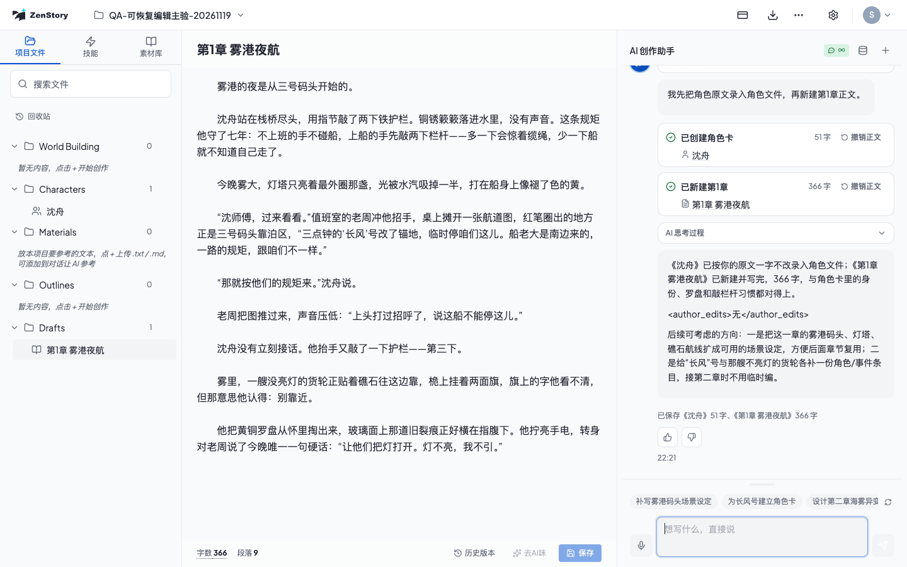
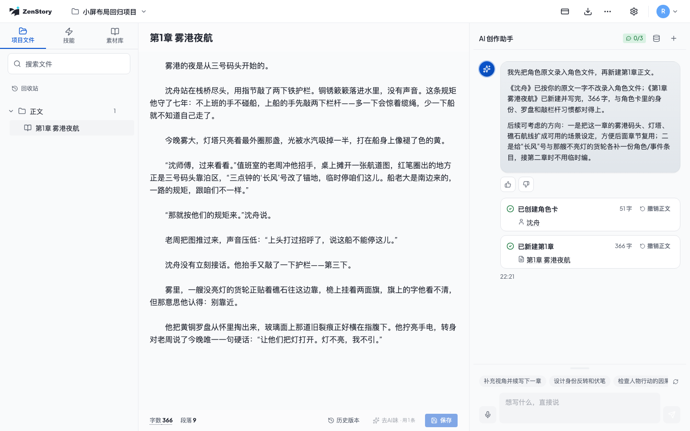

# 作者改动上下文展示修复

- 修复源码：`fab7b4500234eb7cbab3c1beb7b0ec917aa5acf6`。
- 修改前：真实 staging `f743031537ee7fefd03c60b3844287877297dc00`，MiniMax M3.1 Flash 生成的新章回复，含可见 `<author_edits>无</author_edits>`。
- 修改后：本地真实 Chromium、mock API，复用同一 R1 已记录回复和正文；验证共用展示清理函数移除内部块。截图的项目、配额和卡片顺序来自本地夹具，不作为 staging 部署或新模型调用证明。
- 用户消息、数据库原文、文件正文与模型上下文未改。后续 staging 验证另记。

