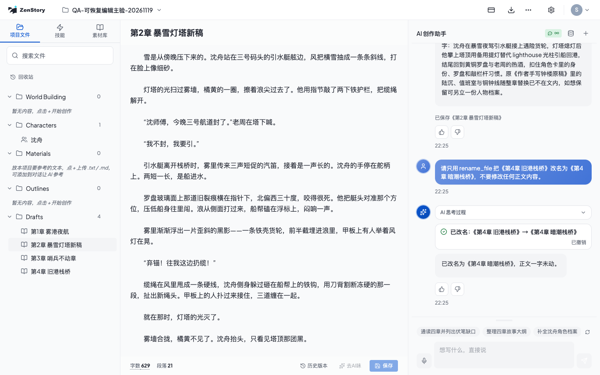
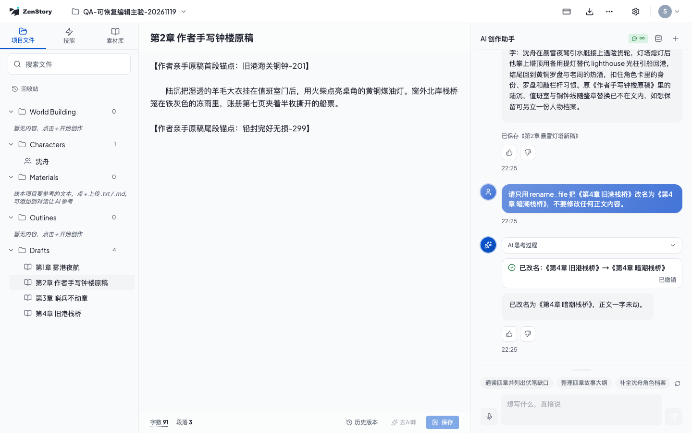
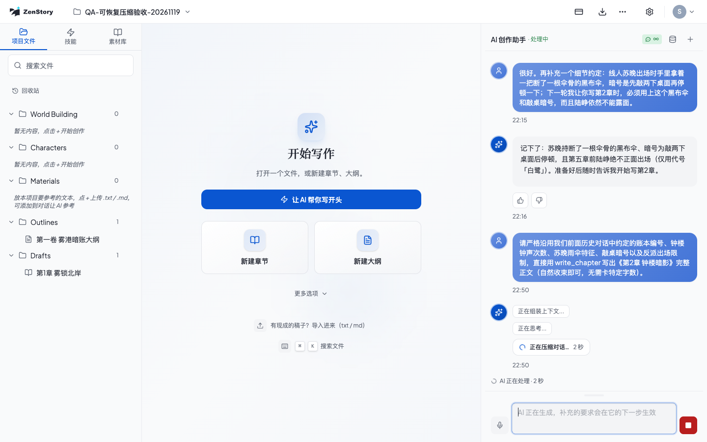
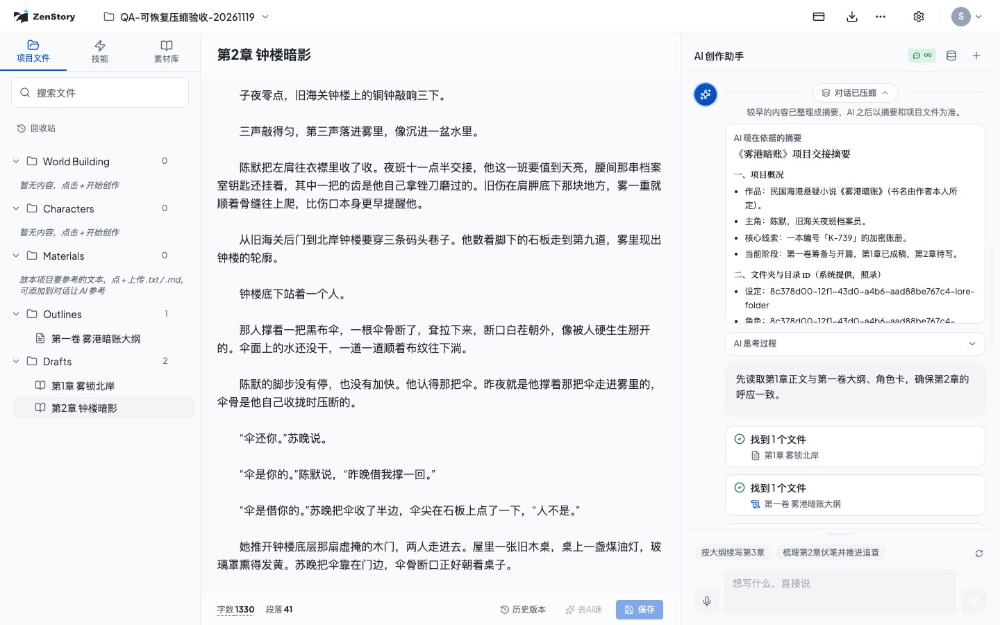
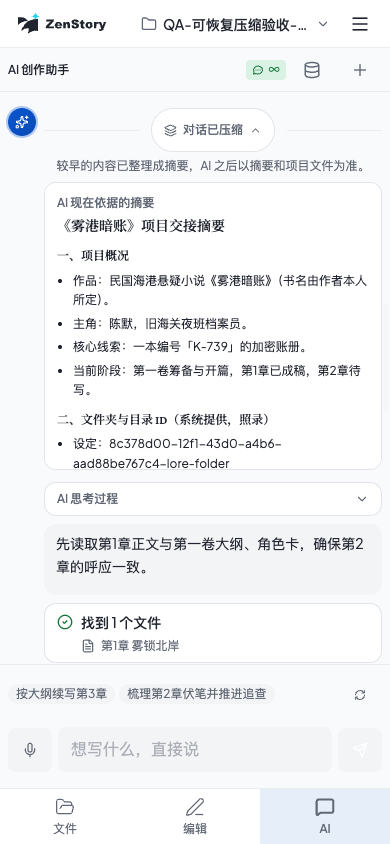
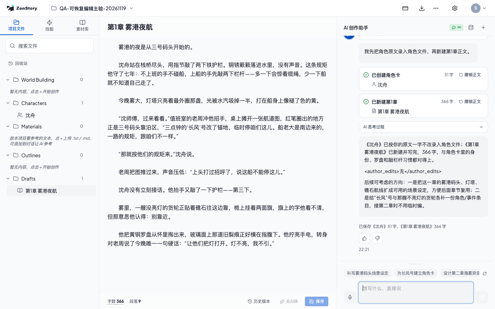
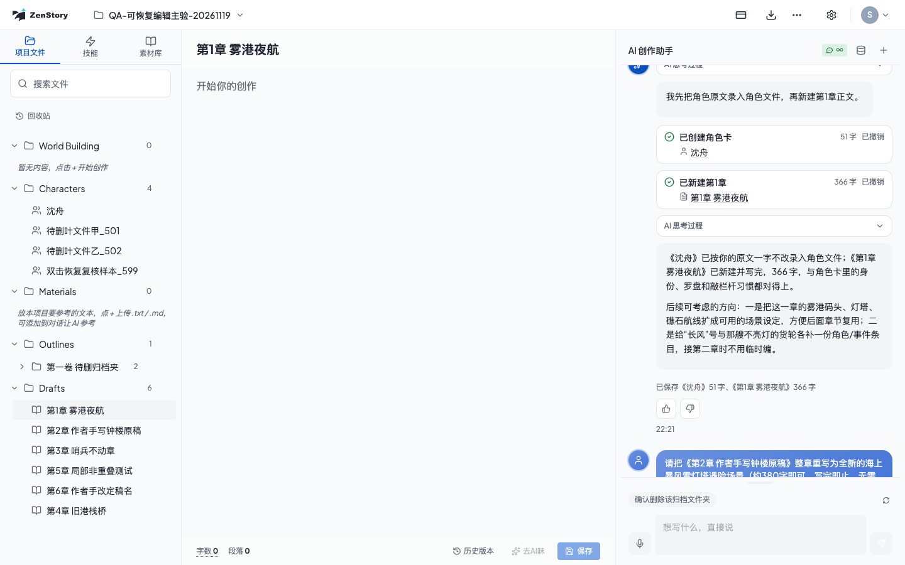
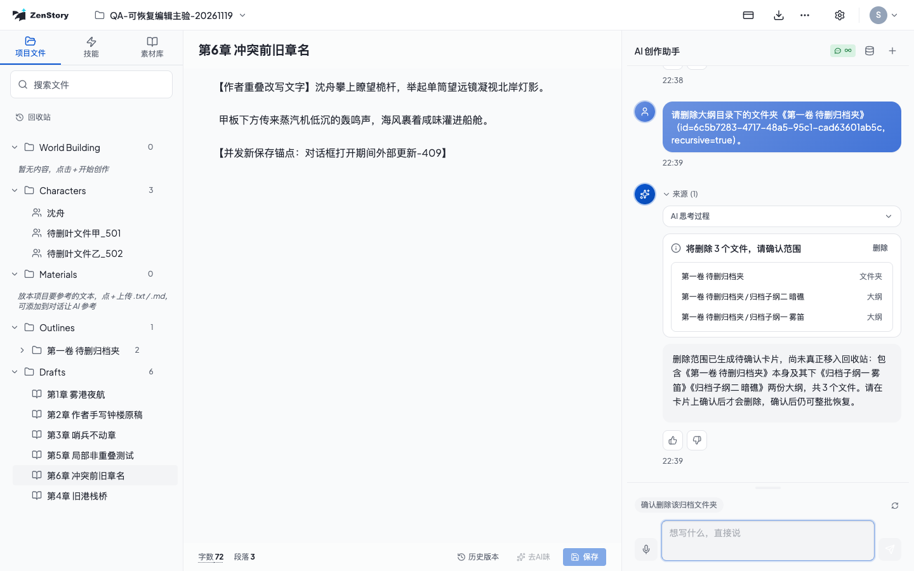
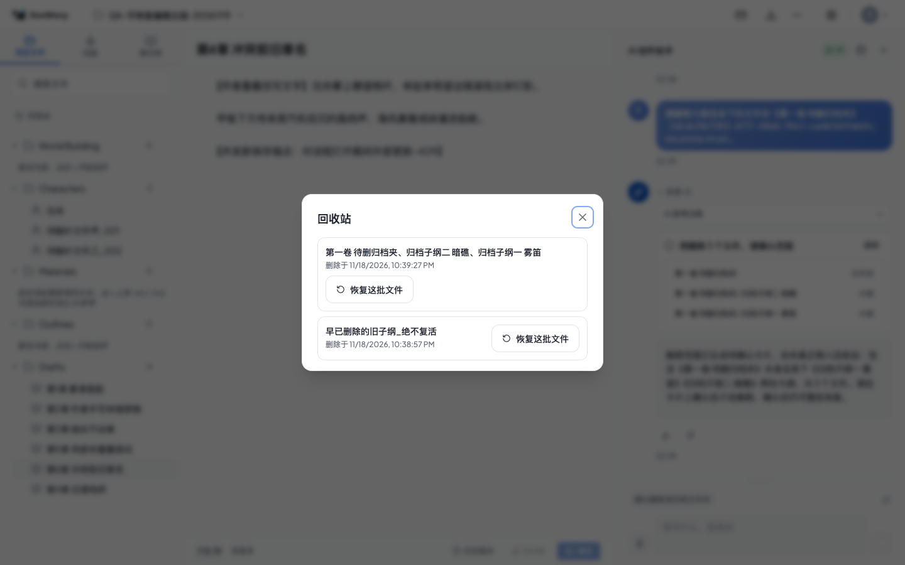

# ZenStory 可恢复改稿：staging 实测报告

2026-11-19 UTC。**已合并到 main，只在 staging 验收；生产尚未发布。**

恢复与并发保护的核心流程通过。仍有两项体验问题需要继续改：整章重写后模型反复微调，使卡片和撤销步骤增多；压缩摘要把内部文件 ID 和宽表直接展示给作者。它们未被写成通过或“已经修复”。

## 改动与测试来源

- [PR #403](https://github.com/zenstory-ai/zenstory/pull/403)：按本轮请求改稿，移除作者来源硬拦截，新增可恢复的正文/标题操作、删除批次、回收站和真实冲突处理。
- [PR #404](https://github.com/zenstory-ai/zenstory/pull/404)：更新旧 E2E 夹具及键盘焦点顺序，没有改产品逻辑或降低断言。
- [PR #405](https://github.com/zenstory-ai/zenstory/pull/405)：隐藏真实回复外露的 `<author_edits>` 内部块，保留用户文本和正常助手正文。
- 基线实测：Web/API/Worker 实际来源均为 `f743031537ee7fefd03c60b3844287877297dc00`。
- 最终前端：`a55254c956f40756e93dd733633bd9ebd6d058a2`。API/Worker 仍为 f743；这次仅改展示层，已比对确认 `apps/server` 内容完全相同，未为对齐 SHA 重部署后端。
- agy 以 tmux 交互模式操作真实浏览器、真实 MiniMax M3.1 Flash；主代理独立检查落库、hash、截图，并完成最后的分页/可见性/显示修复复验。
- 本轮 **11 次有目的的 UI 生成提交，无生成 POST 自动重试**。06:15:32–07:02:00 UTC 的合成项目数据库审计记到 59 条 provider 使用记录：46 条 agent（含工具循环/压缩）及 13 条自动建议。两个计数含义不同；旧项目此前调用已排除。
- 压缩由合成历史的 token 计数受控触发，随后真实生成摘要及正文；**不是 30 万 token 压力测试**。

## 验收结果

| 场景 | 结果 | 实际证据 |
| --- | --- | --- |
| 新章与 source_text 原文创建 | 通过 | 两条真实工具路径均出现；撤销恢复精确空正文，文件 ID、标题、父级、排序保留，刷新仍可用 |
| 作者手稿整章重写并改名 | 功能通过，体验未通过 | 成功保存且其他章 hash 不变，无强制逐点审阅；后续微调导致不能直接点击最初卡片撤销，详见问题 1 |
| 独立改名撤销 | 通过 | 后来的手写追加和调序保持不变，普通撤销不弹二次确认 |
| 局部撤销与并发冲突 | 通过 | 保留 300 余字不重叠追加；桌面/390px 真实重叠框默认保留当前；打开后再保存，实际 POST 409、hash 零写；重读后可正确恢复 |
| 两叶文件删除、恢复及双击 | 通过 | 同一删除批次；原 ID/正文/目录恢复、刷新正确；真实浏览器双击只发 1 次 POST，组件真实双击也只调 1 次且 pending 禁用 |
| 文件夹删除范围及批次恢复 | 通过 | 展示真实层级/类型/数量；取消不删，过期预览 409；恢复不复活早先单独删除的子项 |
| 删除会话后的历史与回收站 | 通过 | 聊天清空后仍可撤销并恢复；GET 失败显示错误和重试，不误报为空 |
| 回收站分页 | 通过 | 已有 255 条合成删除批次，API 第一页 50、next_offset=50；真实 UI 从 50 加载至 100。最终复验未新增或删除数据 |
| 生成中停止 | 通过 | 中途点击停止；已保存半稿 208 字符的 hash 在等待及刷新后相同；真实撤销锚点可恢复空正文；停止账务为 charged/saved_output，与保存证据一致 |
| 旧前端与新后端、旧卡、脏草稿 | 通过 | 保留的旧包真实请求成功；旧卡没有虚假“撤销正文”；新包仍保护未保存草稿 |
| 真实压缩与续写 | 功能通过，摘要可读性待改 | 整轮 85.71 秒，摘要 2,203 字符，后续第 2 章保存；6 项设定约束经逐项阅读保留；桌面/手机折叠、展开及内部滚动实见 |
| 内部标签外露补丁 | 已修复并复验 | a552 staging 打开同一条 R1 历史回复，正常正文保留，内部标签不再出现；没有再次提交生成 |

压缩后逐项核对：主角身份/左肩旧伤/黄铜拆信刀、K-739 账册、子夜钟楼三声铜钟与苏晚会面、断一根伞骨的黑布伞、敲两下后停顿的暗号、陆峥第五章前不正面出场仅提代号白鹭。摘要与真实续写均保持这些要求。

## 遗留问题与下一步

### 1. 整章重写后过度微调，撤销步骤太多

复现：明确要求整章重写并改名、约 380 字、写完即止。模型先完成整章替换，又执行了 9 次小改，聊天堆出多张结果卡。最初整章卡提示先撤销后面的修改，无法直接一键恢复。

已验证：逐步撤销这 9 次改动，再撤销整章替换，可以精确恢复原正文和原标题；其他章不变。**数据可恢复，但没有达到简洁、一次恢复的体验预期。** 下一步应减少同轮自我微调，并明确同轮多次修改在展示与撤销上的产品行为；本轮未擅自改为整轮撤销或移除操作顺序约束。

### 2. 压缩摘要包含内部 ID 和宽表

新摘要含 6 个 UUID，表格宽 813px，手机容器宽约 310px；旧摘要也复现了同类问题。页面没有整体横向溢出，摘要能独立滚动，但作者要阅读技术目录和横向表格，信息负担仍重。新摘要还出现一处 `白_lr` 拼写残片，紧接着自纠为白鹭，实际正文用了正确代号；应一起改善摘要展示与表达质量。

后续验收应以作者能快速读懂“AI 记住了哪些设定”为准，同时保留必要的追溯能力。当前只确认功能与事实保持通过，未把可读性问题标成已解决。

## 已修复：内部上下文标签外露

以下均为真实 staging 截图。前图为 f743 的真实 R1 回复；后图为 a552 重新打开同一条历史回复。后图处于撤销正文之后，编辑器为空属测试操作结果，展示修复仅针对助手消息。

## 其他关键截图

## 证据边界与脚本纠错

原始失败记录保留，补验独立记录：R4 初次点到了改名操作；R5 同一 JS turn 连续 `.click()` 不能等同真实双击；R7 初次素材目录错误，随后长脚本超时重跑产生了额外合成数据，最终按真实 255 条记录验分页；部分初次截图没有把摘要滚到可视区，最终截图已实际检查可见性。没有为这些脚本误差添加无依据的产品补丁。

测试只使用独立 staging 合成账号和项目。图片不含凭据、邮箱或展开的模型思考。没有变更生产来源、迁移生产数据库、创建发布 tag 或执行生产 promote。

## 自动检查与复验入口

- 基线 f743：[CI](https://github.com/zenstory-ai/zenstory/actions/runs/44468824351)、[8 分片 Chromium E2E](https://github.com/zenstory-ai/zenstory/actions/runs/44468824377) 均通过。
- 最终展示补丁 a552：[CI](https://github.com/zenstory-ai/zenstory/actions/runs/44476562855)、[8 分片 Chromium E2E](https://github.com/zenstory-ai/zenstory/actions/runs/44476562953)。最终执行结论与测试窗口关闭状态在交付 issue 中记录。
- #405 修复前后的针对性回归：先复现失败，再通过 158 项相关测试；lint、typecheck/build 通过。实际 staging 复验已确认同一条历史回复隐藏内部块。
- 这些截图均已按实际页面核对；文件来源与截图源版本逐项记录，原始私有调用证据、账务与 hash 校验保留在审计目录，不将凭据提交 Git。
